# Building the test in Build mode

Build mode is the part of the Benchy client for writing tests. It has a three-page wizard that makes a folder of starter files, an editor with one tab per file, a problems panel that checks your files as you work, and buttons to validate and try-run the test. This page follows the PhotoCraft build from the first click to a finished set of files.

One thing to know before you look at the screenshots. They were taken while the test was first built, and the finished test differs in a few ways: the first version drove the application with a different helper file, started it with a fixed CPU renderer, and counted Launch as a tenth scored task. The text below describes the finished files, and says where a picture is of an earlier version.

## Start the wizard

Open Benchy and click **Build** at the top right. The start page offers **New test...** and **Open a test folder...**, and says "No drafts or recent tests yet" if you have none.

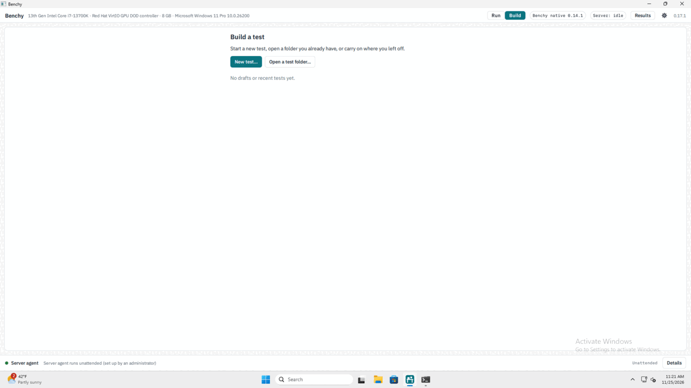

Click **New test...**. The wizard has three pages: Template, Details and Folder.

## Page 1: Template

Pick **Desktop app, timed in its window**. The card explains what you get: Benchy starts the app, keeps its window in front and times each task until the window has finished drawing. The template writes a `run.ps1` that does exactly that, and it is the starting point this guide uses. (The other cards are described in [What an application test is](what-is-an-app-test.md).)

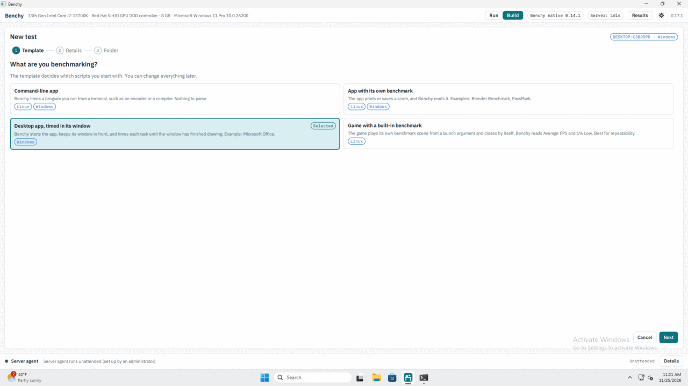

## Page 2: Details

The Details page asks for the facts about the test. Everything on it can be changed later in `benchy-test.toml`, and the page says so.

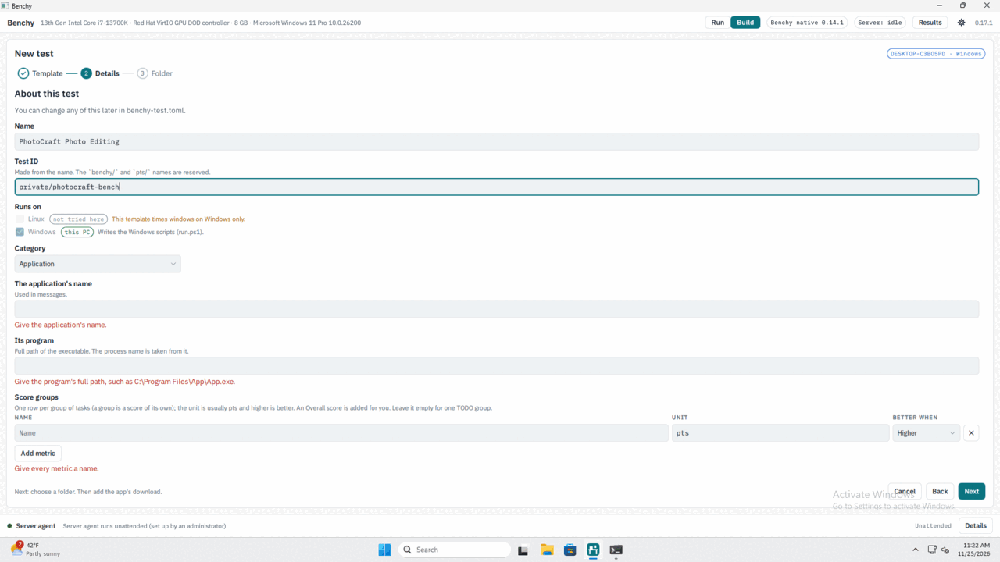

The name is what people will see: `PhotoCraft Photo Editing`. The Test ID is made from it, `private/photocraft-bench`; the `benchy/` and `pts/` names are reserved for tests Benchy ships, and `private/` is for your own. Under "Runs on" the template says plainly that it times windows on Windows only, so Windows is ticked and Linux is greyed out. The category is Application.

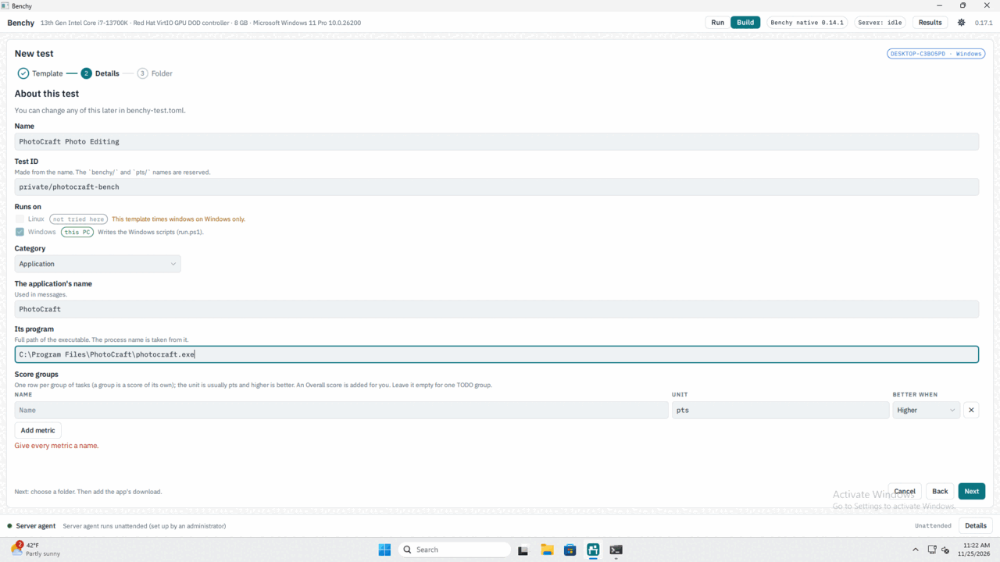

Next come the application's name, `PhotoCraft`, used in messages, and its program, the full path of the executable; Benchy takes the process name from it. The wizard needs something here before it lets you continue, so the example used `C:\Program Files\PhotoCraft\photocraft.exe`. That is a placeholder, because the finished test installs its own copy and `check.ps1` stops looking at a fixed path. You will replace it in a later step.

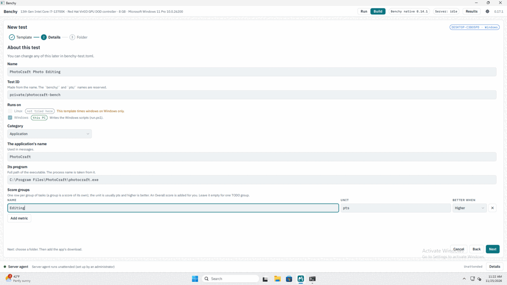

Finally, score groups. A group is a score of its own for a set of related tasks. Each row has a name, a unit, and whether higher or lower is better. PhotoCraft has one group, `Editing`, in points, higher is better. The wizard adds an Overall score by itself. [Scoring notes](scoring.md) says how the two relate. **Next** becomes available once the name, ID and program are filled in.

## Page 3: Folder

A test is a folder. The wizard offers a default location, and you can type your own. PhotoCraft's lives outside the Benchy install, at `C:\bench\photocraft-bench`, so it can be turned into a pack and published from there later. Click **Create**.

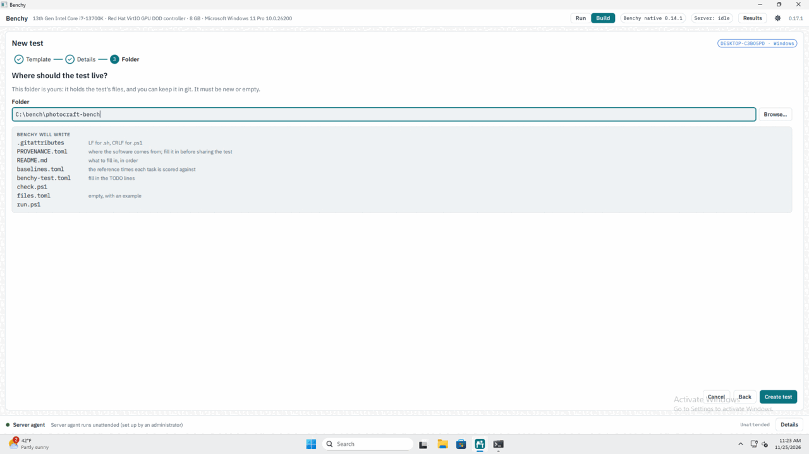

## The workspace

The workspace opens with one tab, `benchy-test.toml`, the list of files on the left, and a problems panel at the bottom. Right away a dialog called **Add a download** opens over it, waiting for an address. The problems panel has one hint already: the license class of the software is unstated, which is fixed in `PROVENANCE.toml` later.

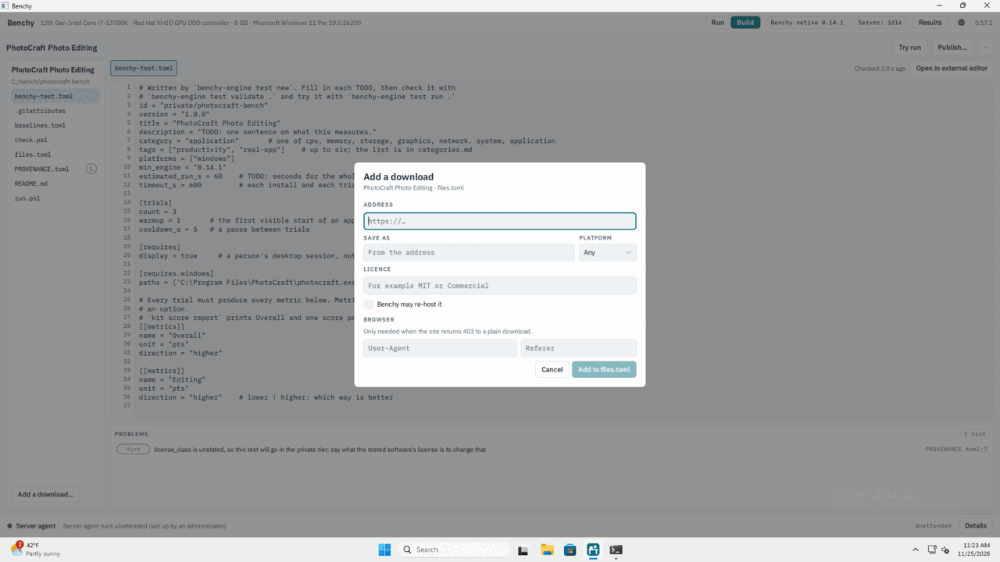

## Add the application's download

Paste the address of the application's download into the dialog. For PhotoCraft that is the portable zip of version 0.23.1 for Windows from the project's GitHub releases page. Set the platform to Windows and enter the license, `Apache-2.0 OR MIT`. Then click **Add to files.toml**.

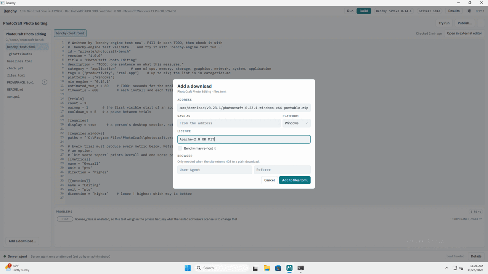

Benchy downloads the file once, and writes the entry for you. The problems panel says "Added photocraft-0.23.1-windows-x64-portable.zip to files.toml (143135209 bytes, sha256 6317e764ecfa...)". Nobody typed the checksum.

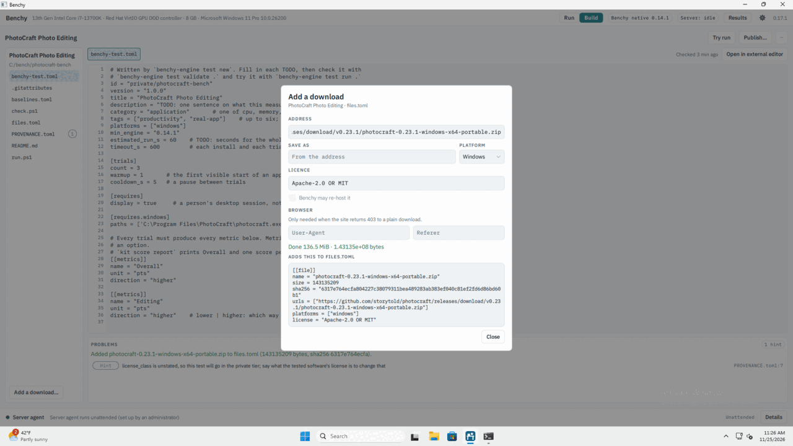

The finished entry in `files.toml`:

```toml
[[file]]
name = "photocraft-0.23.1-windows-x64-portable.zip"
size = 143135209
sha256 = "6317e764ecfa804227c38079311bea489283ab383ef040c81ef2fd6d86bd60b1"
urls = ["https://github.com/storytold/photocraft/releases/download/v0.23.1/photocraft-0.23.1-windows-x64-portable.zip"]
platforms = ["windows"]
license = "Apache-2.0 OR MIT"
```

The engine fetches every listed file, checks the size and checksum, and puts it in the test's install folder before `install.ps1` runs. That is how a 143 MB program reaches a machine without being part of the test pack. If the site refuses a plain download with a 403 error, the dialog has User-Agent and Referer boxes for that case.

## What the wizard wrote

Open each tab and you will find the shape of a test, full of TODO notes. Nothing is edited yet. The tabs are `benchy-test.toml`, `run.ps1`, `check.ps1`, `files.toml`, `PROVENANCE.toml`, `README.md`, `baselines.toml` and `.gitattributes`.

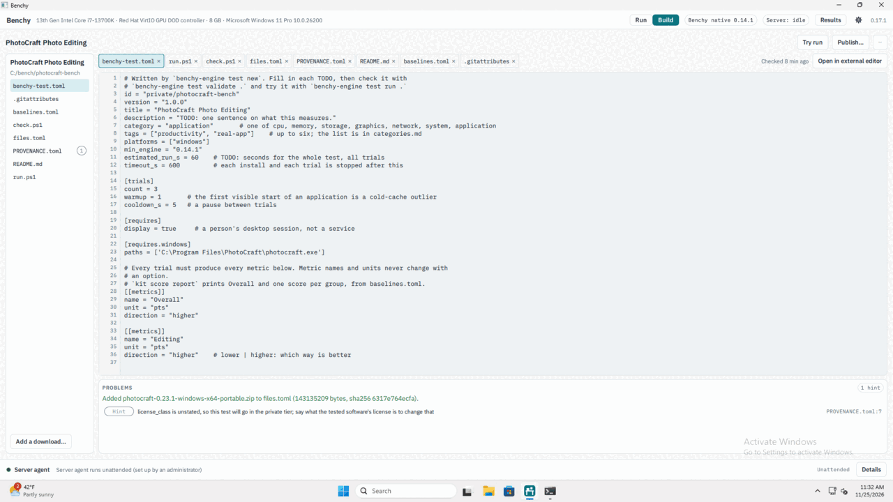

`benchy-test.toml` has a placeholder description, `estimated_run_s = 60`, `timeout_s = 600`, a fixed path under `[requires.windows]`, and the metrics Overall and Editing. `run.ps1` is a skeleton that starts the application and times a single block called `FirstTask`.

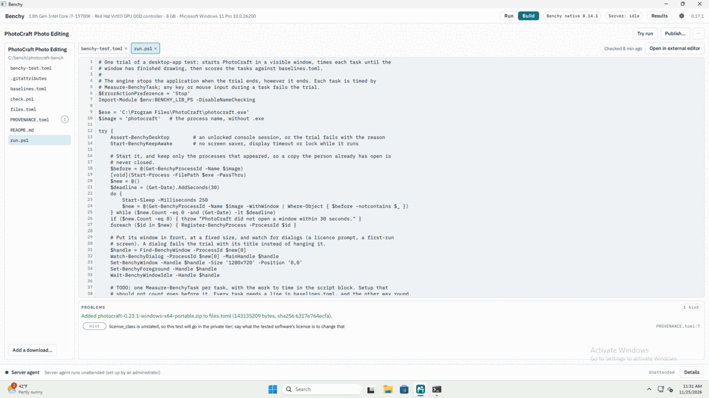

`check.ps1` only checks that the program path exists. `baselines.toml` has one task, `FirstTask`, at 1.0 second. Everything from here is replacing TODOs with what your application needs.

## Edit 1: benchy-test.toml

Replace the description with what is measured, and say anything a reader would need before comparing two results: that the document is generated at install, and which renderer is used. Set `license`, `min_engine` (the lowest engine that has the features you use; PhotoCraft uses `0.14.1`) and `tags`. Remove the fixed `[requires.windows]` path, because the test installs the application itself. Set the `[trials]` block from the [planning page](planning.md), and add one `[[metrics]]` block for each task, in seconds, lower is better. The first lines of the finished file:

```toml
id = "private/photocraft-bench"
version = "1.0.0"
title = "PhotoCraft Photo Editing"
category = "application"       # one of cpu, memory, storage, graphics, network, system, application
tags = ["productivity", "real-app"]    # up to six; the list is in categories.md
platforms = ["windows"]
license = "Apache-2.0 OR MIT"
min_engine = "0.14.1"
estimated_run_s = 360    # measured: warm-up + 3 trials took about 5 to 6 min on the build VM (CPU path)
timeout_s = 600         # each install and each trial is stopped after this (a trial takes about 72 s on the build VM); install.ps1's own limits fire first
```

(The `description` line sits between `title` and `category`; it is long, so it is left out here. The build VM is the virtual machine the test was built on.) The `[requires]` block in the finished file is one line, `display = true`: the test needs a person's desktop session, not a service.

Beside Overall and Editing, each task gets a seconds metric:

```toml
[[metrics]]
name = "Open PSD (s)"
unit = "s"
direction = "lower"
```

The seconds are what a person wants to read; the two scores are what goes on a chart. The description names the renderer because results from different renderers must not be compared blindly.

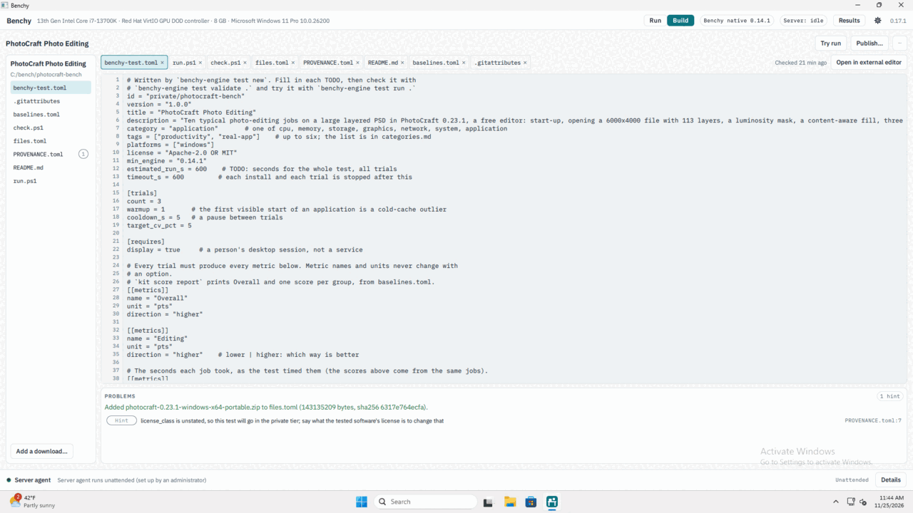

## Edit 2: install.ps1

Add a new file, `install.ps1`. The engine runs it once per install, after the downloads are in place. For PhotoCraft it does four things:

1. Unpacks the zip into the test's install folder.
2. Generates the PSD from the recipe by playing `psd-gen/steps.jsonl` into `photocraft-cli serve`.
3. Checks the file against the numbers in `psd-gen/PINS.toml` (see [Making a fixture file](fixture.md)).
4. Makes the settings folder every trial starts from, by opening the app once with its settings in a folder of our choosing, changing a few preferences, and quitting.

The settings it changes are the ones that could put something on screen during a timed task:

```powershell
    [void](Invoke-PcCommand -Command 'prefs.set' -Params @{ values = @{
        'performance.renderingMode' = 'auto'; 'general.automaticallyCheckUpdates' = $false
        'fileHandling.autosave' = $false; 'fileHandling.recoverOnLaunch' = $false } })
```

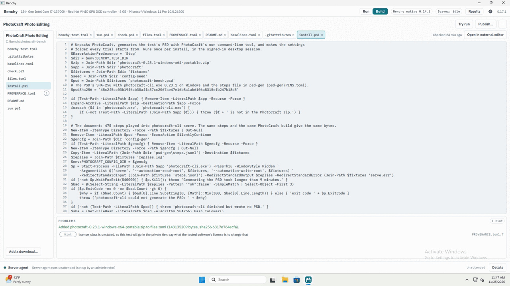

Two lines in `install.ps1` are worth copying into any test that starts a helper program from PowerShell. The first makes the process object remember its exit code, and the second stops the helper if it has not finished in time:

```powershell
$null = $p.Handle    # without this, Start-Process -PassThru gives no ExitCode once the process has ended
if (-not $p.WaitForExit($generateSeconds * 1000)) { $p.Kill(); throw ('Generating the PSD took longer than ' + ($generateSeconds / 60) + ' minutes, so the install was stopped. This computer is too slow for the test, or photocraft-cli is stuck.') }
```

The [troubleshooting page](troubleshooting.md) says why the first line is there.

## Edit 3: the helper that talks to the application

`run.ps1` and `install.ps1` both need to send commands to PhotoCraft and read the answers. That code lives in one more file, `photocraft-bridge.ps1`, which both scripts load. It has helpers to start the connection, send one control method, run an engine command, start a long job and wait for it, and read a field the application might not send.

The screenshots in this guide show an earlier version of this file, `photocraft-control.ps1`, which opened a network connection to the application directly. It was replaced after a corporate virus scanner refused to run it. The [corporate machines page](corporate-machines.md) tells that story and shows what the helper does now. If your application offers a command-line client for its control channel, start with that.

Add the recipe files from the fixture step in a `psd-gen` folder at the same time.

## Edit 4: check.ps1

The check runs before install and before each run. It exists so that a machine that cannot do the job says so up front, in words, instead of failing halfway or posting a bad score. The wizard's check looked for a program path; PhotoCraft's replacement asks for room for the document and enough memory:

```powershell
$dir = if ($env:BENCHY_TEST_DIR) { $env:BENCHY_TEST_DIR } else { $PSScriptRoot }
$drive = Get-PSDrive -Name ((Resolve-Path -LiteralPath $dir).Path.Substring(0, 1)) -ErrorAction SilentlyContinue
if ($drive -and $drive.Free -lt 5GB) {
    Write-Output ('BENCHY-MISSING {"what":"5 GB of free disk space for PhotoCraft, the test PSD and the saved copy","fix":"Free up space on ' + $drive.Name + ': (it has ' + [math]::Round($drive.Free / 1GB, 1) + ' GB free), then run again."}')
    exit 1
}
```

A line beginning `BENCHY-MISSING` followed by a small JSON object is how a script tells Benchy what is missing and how to fix it; Benchy shows both to the person running the test. The memory check works the same way, and a last check asks Benchy's own `kit desktop check` whether the session can be drawn on at all (not a locked screen, not a disconnected remote session).

## Edit 5: run.ps1

`run.ps1` is where most of your time goes. It does one trial. The scripts set the whole structure up in a few lines at the top, and the shots scroll down the file.

```powershell
$ErrorActionPreference = 'Stop'
Import-Module $env:BENCHY_LIB_PS -DisableNameChecking
. (Join-Path $env:BENCHY_TEST_DIR 'photocraft-bridge.ps1')
```

`BENCHY_LIB_PS` is Benchy's helper library for PowerShell; `BENCHY_TEST_DIR` is the test's install folder, `BENCHY_RUN_DIR` is this trial's own folder, and `BENCHY_TRIAL` is the trial number (0 for the warm-up).

**Launch.** The first thing a trial does is start the application with its control port, a token file and the folders it may read and write, and wait until it is ready. "Ready" means the window exists, the port answers, and nothing is waiting on the canvas: no dialog and no running job. The stopwatch runs from the moment the process starts.

```powershell
    $port = Get-PcFreePort
    Start-PcBridge -Cli (Join-Path $app 'photocraft-cli.exe') -Port $port -TokenFile $tokenFile
    & {
        $sw = [System.Diagnostics.Stopwatch]::StartNew()
        $script:proc = Start-Process -FilePath $exe -PassThru -ArgumentList @('--control', $port, '--control-token-file', $tokenFile, '--automation-read-root', $fixtures, '--automation-write-root', $workDir)
        Register-BenchyProcess -ProcessId $script:proc.Id
        Set-PcApp -Process $script:proc
```

`Register-BenchyProcess` tells Benchy to close that process when the trial ends, however it ends, so a failed trial does not leave the application running. After the clock stops, the script finds the window, puts it at a fixed size and position, brings it forward, and starts watching for dialogs, none of which is timed:

```powershell
    $script:Handle = Find-BenchyWindow -ProcessId $proc.Id
    Watch-BenchyDialog -ProcessId $proc.Id -MainHandle $script:Handle
    Set-BenchyWindow -Handle $script:Handle -Size '1280x720' -Position '0,0'
    Set-BenchyForeground -Handle $script:Handle
    Wait-BenchyWindowIdle -Handle $script:Handle
```

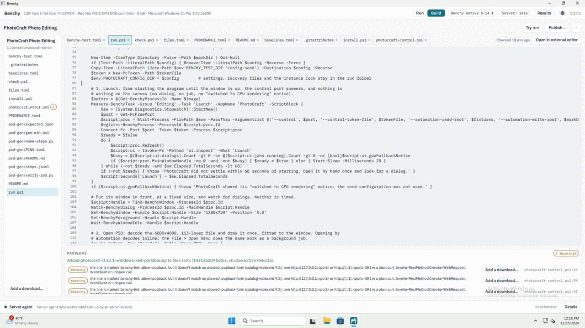

**The tasks.** Each task is one call to the `Invoke-PcTask` function you saw in the planning page. The Luminosity Mask task shows the whole pattern in nine lines: select the layer (not timed), run two commands (timed), check that the layer now has a mask:

```powershell
    Invoke-PcTask -Key 'LuminosityMask' -Title 'Luminosity Mask' -Setup {
        [void](Invoke-PcCommand -Command 'layer.select' -Params @{ layer = 'Rock 03' })
    } -Work {
        [void](Invoke-PcCommand -Command 'select.loadLuminosity' -What 'Luminosity Mask')
        [void](Invoke-PcCommand -Command 'layer.layerMask.revealSelection' -What 'Luminosity Mask')
    } -Check {
        Assert-Pc ([bool](Get-PcField (Find-PcLayer 'Rock 03') 'hasMask')) 'The luminosity mask was not added to Rock 03.'
    }
```

The `-What` names the step in error messages, so a failure reads "Luminosity Mask (engine.execute) failed in PhotoCraft: ..." and not a bare error.

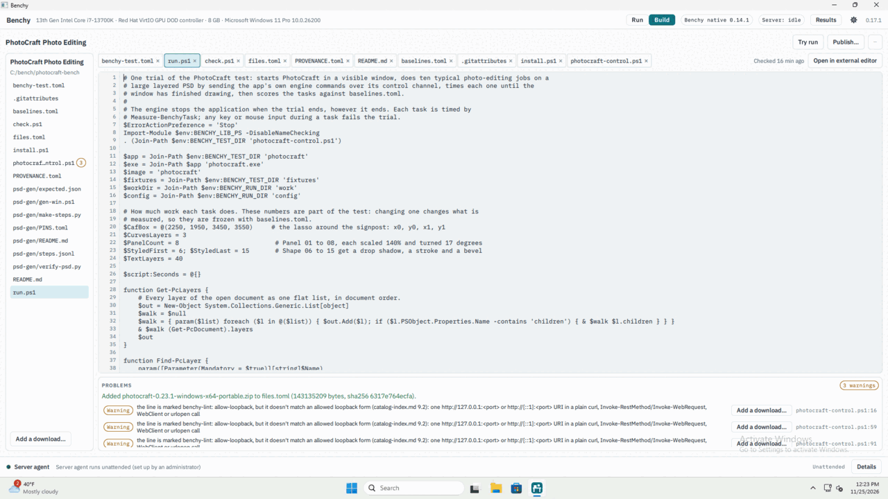

**The end.** After the last task the script asks the application how it drew, then writes the results. Information lines (`Write-BenchyInfo`) are context kept with the result; metrics (`Write-BenchyResult`) are the numbers; and `Write-BenchyScores` computes Overall and the Editing score from `baselines.toml`.

```powershell
    Write-BenchyInfo -Key 'PhotoCraft' -Value '0.23.1 (windows-x64 portable zip)'
    Write-BenchyInfo -Key 'PhotoCraft render path' -Value $rpath.Text
    Write-BenchyInfo -Key 'PhotoCraft graphics adapter' -Value $rpath.Adapter
    Write-BenchyInfo -Key 'PhotoCraft CPU rendering notice' -Value $noticeState
```

and in the `finally` block, which runs however the trial ended, it quits the application, stops the helper process and deletes the file it saved:

```powershell
} finally {
    if ($script:Pc) {
        try { [void](Invoke-Pc -Method 'app.quit' -TimeoutSeconds 10) } catch { }
    }
    Stop-PcBridge
    Remove-Item -LiteralPath (Join-Path $workDir 'out.psd') -Force -ErrorAction SilentlyContinue
    Remove-Item -LiteralPath $tokenFile -Force -ErrorAction SilentlyContinue
}
```

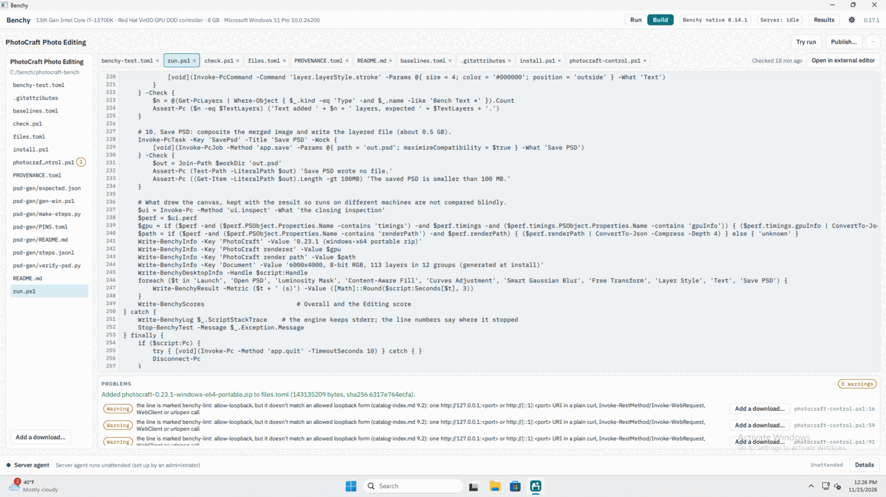

## Edit 6: baselines.toml

`baselines.toml` lists the time a reference machine took for each scored task. The score of a task is its baseline divided by the measured time, times 1000. So at first you put a placeholder, 1.0 second, for every task, and replace each with the median of a measured run once you have one. The file also records where the numbers came from, which matters later:

```toml
reference = "PROVISIONAL, CPU path only: medians of 3 trials after 1 warm-up on the build VM (a virtual machine on a 13th Gen i7-13700K, no GPU, so PhotoCraft drew with the CPU compositor on Windows' WARP software adapter, 1920x1080, Defender on), Benchy 0.16.2, PhotoCraft 0.23.1. Scores from a machine that drew on a GPU are not comparable to these until real-GPU baselines replace them, before this test leaves private/."

[[task]]
group = "Editing"
key = "OpenPsd"
baseline_s = 4.924
```

The `key` of each task is the name `run.ps1` passes to `Measure-BenchyTask -Task`. Changing a baseline, or adding or dropping a task, changes what the scores mean, so the file warns that it is a new major version of the test.

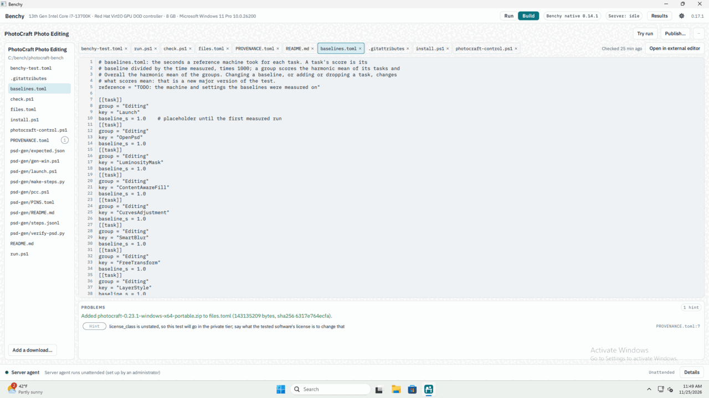

## Edit 7: PROVENANCE.toml and README.md

`PROVENANCE.toml` says where the software came from and what license it is under, so that nobody has to guess later. PhotoCraft's says: the project and its address, the version, `license = "Apache-2.0 OR MIT"`, `license_class = "free"`, and that the test modifies nothing it ships. Its notes record how the license was checked (the repository carries both license files, and `Cargo.toml` says MIT OR Apache-2.0), that the trademarked name and logos are outside it and not shipped, that the bundled font is under the SIL Open Font License, and that the test content is procedural.

`README.md` is for a person who finds the folder. Say what the test measures, how it works in a paragraph, what the numbers mean and what to keep your hands off. Check it against `benchy-test.toml` when you finish; PhotoCraft's README once said the CPU renderer was used in one place and described a provisional baseline in another, which contradicted each other when the renderer became automatic.

`.gitattributes` keeps line endings right when the folder is kept in a source repository: `.sh` files with LF, `.ps1` files with CRLF.

The test is now complete. The next page validates it and runs it.
