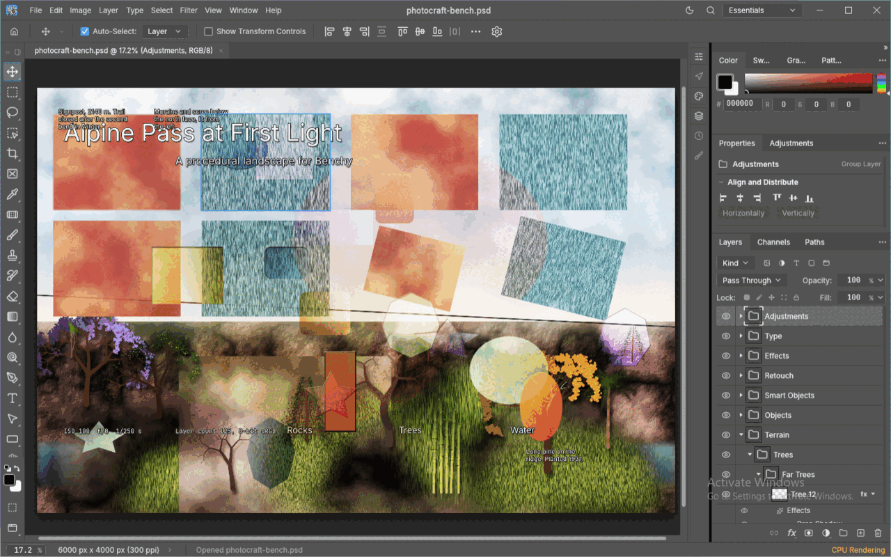

# Making a fixture file

An application test usually needs something to work on: a document, a project, a database, a scene. That file is part of the test. If it differs from one machine to the next, the scores mean nothing, so it has to be the same, byte for byte or at least picture for picture, everywhere the test runs.

This page uses the PhotoCraft fixture, a 6000x4000 pixel PSD with 113 layers in 12 groups, to show how to make one. Your application will have a different file, but the questions are the same.

## Generate it, do not ship it

The PhotoCraft file is 480 MB. A test pack that carried it would be enormous, and the file would need a home to download from. Instead the test carries a recipe of about 65 KB and builds the file on each machine at install. The recipe is 475 lines of JSON, one request per line, played into PhotoCraft's own command-line tool, `photocraft-cli serve`. The first line makes the document, and the last saves it:

```json
{"id":1,"method":"doc.new","params":{"width":6000,"height":4000,"depth":8,"mode":"rgb","resolution":300,"background":"white","name":"photocraft-bench"}}
```

```json
{"id":475,"method":"doc.save","params":{"path":"photocraft-bench.psd","maximizeCompatibility":true}}
```

In between are the steps that paint a sky gradient, render clouds and trees with fixed seeds, add noise, make selections and masks, add adjustment layers and layer styles, convert layers to smart objects and create text. A typical step looks like this:

```json
{"id":3,"method":"engine.execute","params":{"command":"paint.gradient","params":{"from":[0,0],"to":[0,2400],"colors":["#1b4a8c","#6f9fd0","#e9d7bd"]}}}
```

The recipe is not written by hand. `psd-gen/make-steps.py` writes it from a random generator with a fixed seed, and the same seed always writes the same file:

    python3 make-steps.py --seed 20261125

That script runs once, on the author's machine, and its output `steps.jsonl` is what the test ships. It is not a runtime dependency, so the machines being benchmarked do not need Python.

### Why use the application's own tool

The choice of tool matters. Photoshop would need a license and a hosted file. Free libraries such as psd-tools can read layered files but cannot write adjustment layers, layer styles or smart objects. PhotoCraft's own command-line tool writes all of them. The tradeoff is that the file is "PhotoCraft flavored" and not one Photoshop saved; a real Photoshop file would exercise code paths this one does not. The test's description says what is measured, and that is what is measured.

### Procedural content only

Every picture in the file is made by PhotoCraft's own seeded render filters, gradients, noise and shapes, so the file contains nobody else's work and no copyright question arises. The text layers use Inter, a font compiled into PhotoCraft. An early version used a font that is only present on some Linux systems, and PhotoCraft warned that it was not installed when the file was opened on Windows; a missing font changes the layout of text, so results would differ between machines. Use only fonts that travel with the application.

## Pin the application

The recipe only gives the same file if the same version of the application plays it. So the application's download is pinned in `files.toml` by size and SHA-256 checksum. Build mode fills those in for you when you paste an address into its Add a download dialog, as the [build page](build-it.md) shows; nobody types a checksum.

## Size the file for the smallest machine

The first PhotoCraft file would not open. PhotoCraft estimates the memory a PSD needs from the rectangle of every layer, plus a workspace the size of the biggest layer, and refuses a file above a limit. The first file estimated 2,596,462,368 bytes against a limit of 2,571,327,488. Two things were costing too much: five fill layers were stored as full-canvas pixel planes (96 MB each), and the sky and the retouching layers were larger than they needed to be. Fill layers became solid-color shape layers, the sky was cut to the top 2500 pixels, and the retouch layers were made smaller. Empty tiles are free in PhotoCraft, so a layer that covers only the area it needs costs almost nothing.

The finished document estimates at about 1.65 GiB. That is the number `check.ps1` is protecting when it asks for 8 GB of memory.

Your application will have its own version of this limit. Find it before you design the fixture, and design for the smallest machine the test is meant to run on.

## Is it the same file every time?

Generate it more than once, and on more than one platform, and compare. PhotoCraft's fixture was generated four times:

| Run | Time | Peak memory | Size | Checksum starts |
|---|---|---|---|---|
| Windows 1 | 19.8 s | 2893 MiB | 480,636,652 | `45c2f5cc` |
| Windows 2 | 19.3 s | 2884 MiB | 480,636,652 | `45c2f5cc` |
| Linux 1 | 51.3 s | 2866 MiB | 480,636,652 | `0ee0af72` |
| Linux 2 | 51.3 s | about 2866 MiB | 480,636,652 | `0ee0af72` |

Each platform repeats itself exactly. Windows and Linux write files of the same size but different bytes. But when PhotoCraft opens either file and renders the whole composite to a 1500 pixel picture, the two pictures are identical, so the pixels agree.

That decides how the install checks the file. It does not insist on one checksum for the file. A different PhotoCraft build could write the same picture in different bytes and fail an install that was fine. Instead the install checks the file's size, the document's width, height and depth, how many layers, groups, masks, adjustment layers, styled layers, smart objects and text layers it has, and the checksum of a 1500 pixel render of the composite made by PhotoCraft itself. All of those numbers live in one small file, `psd-gen/PINS.toml`:

```toml
[fixture]
file = "photocraft-bench.psd"
steps_sha256 = "1587a7333fd0f94b3ab3a05b91dafdcb9719275c6bd85f0bf7e6b9ff1c967bda"
size = 480636652
# photocraft-cli.exe 0.23.1 on Windows (Windows build VM, two runs, identical)
sha256_windows = "45c2f5cc03b19f6cb30affa37cc2067ae47e16b8a1ab6106a8315efb247b18d5"
# photocraft-cli 0.23.1 on Linux x86_64 (Linux test VM, two runs, identical): same size, bytes differ from Windows
sha256_linux = "0ee0af720018259328dfe2be34304ea351934c88a0e4e1b0d1abc8fec4740fa7"
# doc.render {maxSide:1500} of the opened file: identical on Windows and Linux
composite_1500_png_sha256 = "9c9bd283c0699c2a0b235e9e8d01229fb984c3a21f021f73353efa913aa4af17"
[counts]
layers = 113
groups = 12
masks = 26
adjustment_layers = 15
styled_layers = 34
effects = 65
smart_objects = 8
smart_filters = 2
text_layers = 10
```

The file's own checksum is still written into every result as an information line, `PSD file sha256`, so you can see it when two machines disagree. The comments name the virtual machines the author used.

## Check the file with a second program

The application wrote the file, so it should not be the only judge of it. The author read it back with two readers:

1. `photocraft-cli info --detail --compact` prints the layer tree as JSON. This is the same reader the install uses to check the counts.
2. `psd-gen/verify-psd.py`, which opens the file with psd-tools, an independent library, and compares its counts with `expected.json`. Run it as `python -I verify-psd.py FILE expected.json` in a virtual environment with psd-tools installed.

Both agreed on 125 rows (113 layers and 12 groups), 8-bit RGB, 300 pixels per inch and no warnings.

## Open it in the application once

Finally, open the fixture in the real window and look at it. The author did that over PhotoCraft's control channel and took a screenshot: the full file at 17 percent zoom, with the Layers panel showing the groups.



The first time, a "Switched to CPU rendering" box sat over the canvas, because the machine had only a software graphics adapter. That is the first sign that the test has to settle the renderer question before it times anything. The [troubleshooting page](troubleshooting.md) shows how the finished test does it.
