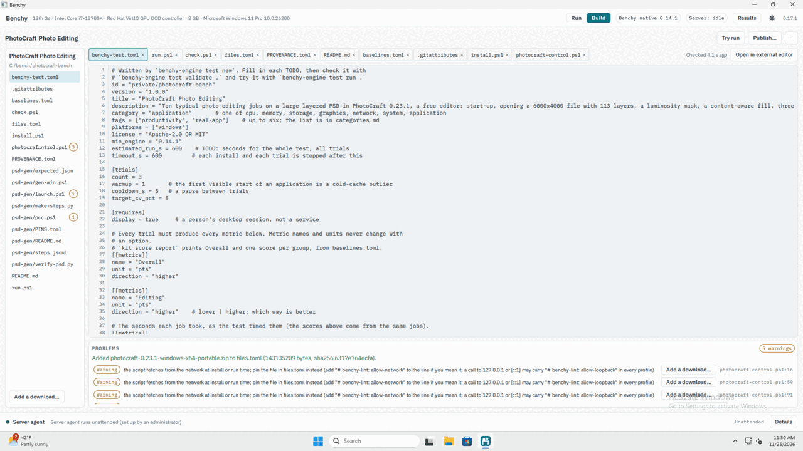
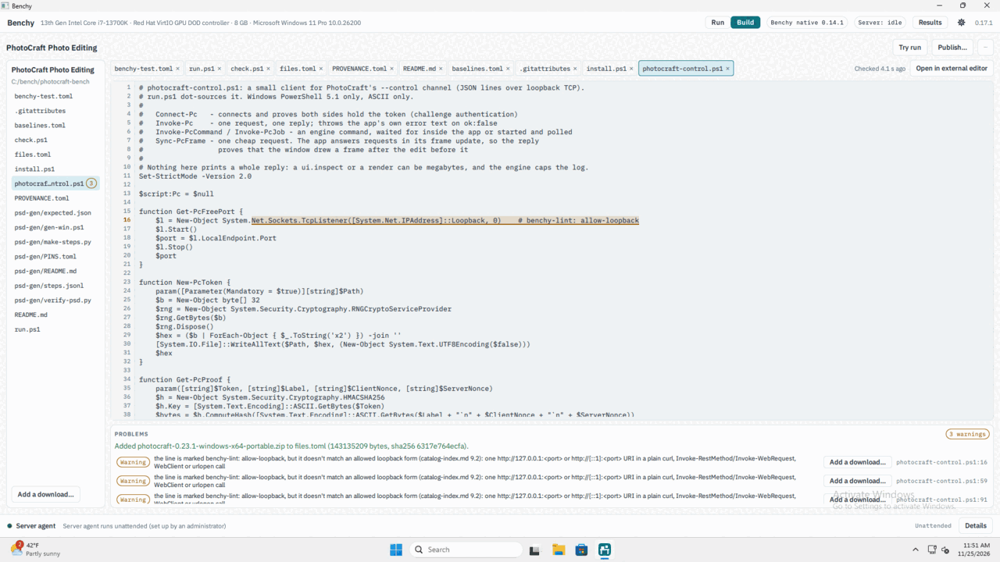
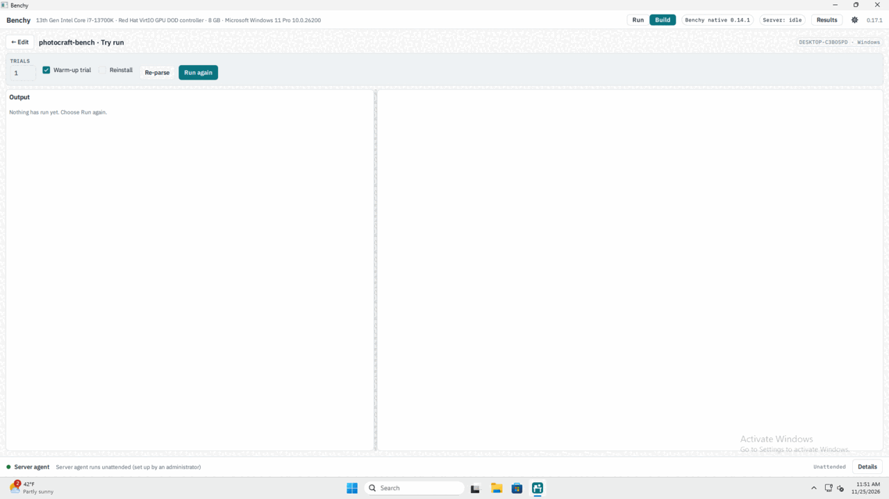
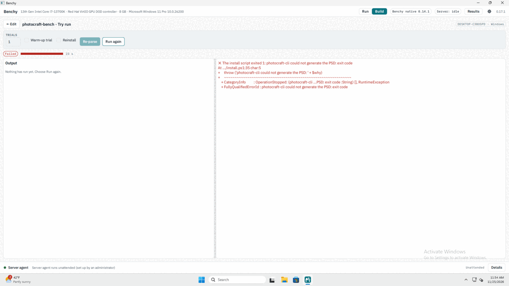
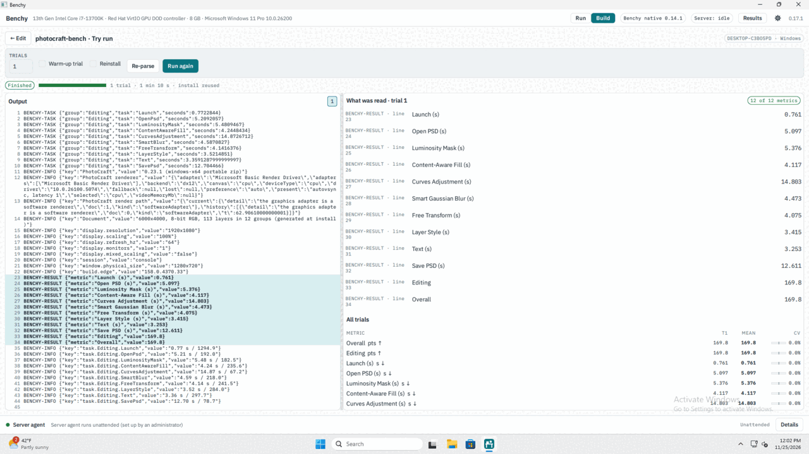
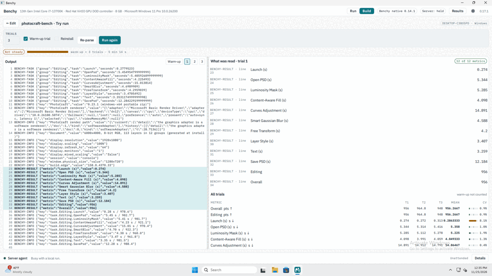
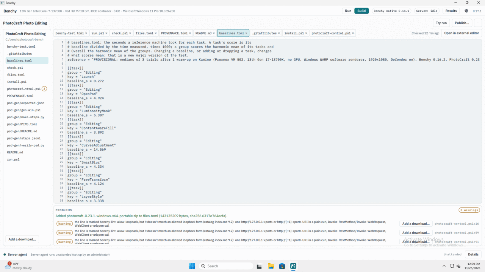
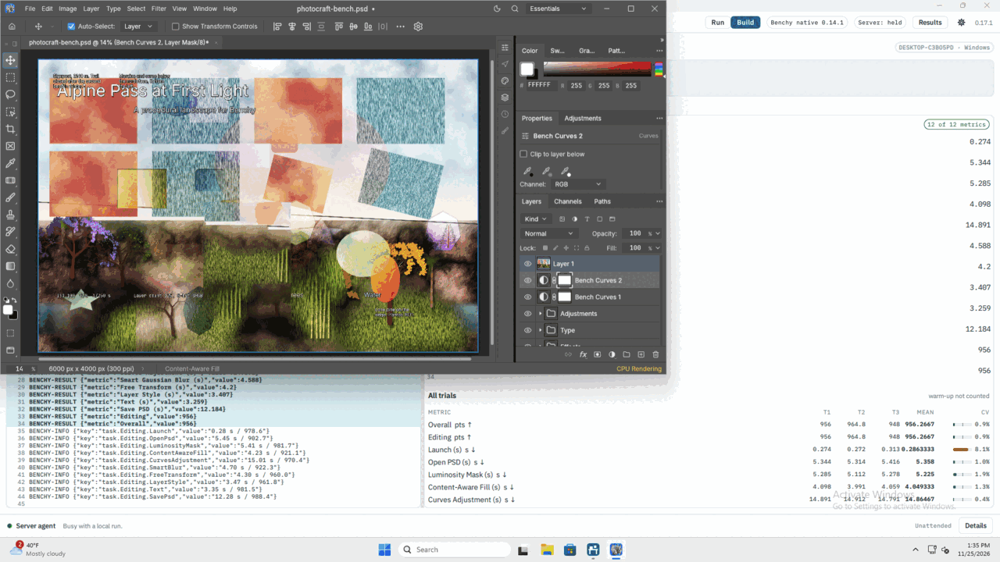

# Validate, try-run, full run

With the files in place, you check the test, run it once to see whether it works, run it several times to see how steady it is, and write down what a reference machine measured. This page covers those four steps and how to read what Benchy shows you.

## Validate

Open the **...** menu at the top right of the editor and choose **Validate now**. The editor also checks as you work, but this runs every check and shows the list in the problems panel. The same check is available from a terminal, in the test's folder:

    benchy-engine test validate .

Each finding is an error, a warning or a hint, with the file and line. An error means the test is wrong. A warning means something looks risky, and a hint is a suggestion; neither stopped a try-run. Fix every error. For every warning, either fix it or understand it.

The first validation of the PhotoCraft test had no errors and three warnings, all in the first version of the helper file. The check looks for scripts that open a network connection while a test runs, since downloads belong in `files.toml`, and the helper opened a connection to the application on the local machine. The checker allows a `# benchy-lint: allow-loopback` comment on such a line, but only for an HTTP address; the application's control channel is plain JSON lines over TCP, so no comment could satisfy it, and the warnings were accepted. They did not block a try-run.

That whole class of warning went away when the helper was replaced (see [Corporate machines](corporate-machines.md)), because the new helper opens no connection at all. <!-- unverified: validate was not re-run on the final files for this guide -->

## Try run: one trial

Click **Try run**. The page has a Trials box (set to 1), a **Warm-up trial** checkbox, a **Reinstall** checkbox, **Re-parse** and **Run again**. Click **Run again** to install the test and run one trial.

Expect the first try-run to fail. That is what it is for. PhotoCraft's first one failed in the install after 23 seconds:

The message names the script and says what it was doing, which is how it was possible to find the cause: a line missing from `install.ps1`. [Troubleshooting](troubleshooting.md) has it.

When a trial gets all the way through, the page shows two panes. On the left is everything the scripts printed. On the right, "What was read", is each line Benchy understood as a result, with the metric and its value, and a count such as "12 of 12 metrics" that tells you nothing is missing. Below that is the table of all trials.

Here Overall is 169.8, not 1000, because the baselines were still the 1.0 second placeholders. The score is the baseline over the measured time, so a placeholder of 1.0 second against a 5 second task scores 200. That a number appeared at all is the point: it shows that every result was found and the scores were computed.

A try-run by default does one trial with no warm-up and keeps the install between runs. It reinstalls only when an install input has changed, and every file in the folder is an install input except `benchy-test.toml`, `run.ps1` and `check.ps1`. So editing the run script costs one trial, not a rebuild. Editing the helper file, `photocraft-bridge.ps1`, or the baselines does trigger one, and for PhotoCraft a reinstall means generating the document again, which takes a minute or more. Tick **Reinstall** to force a rebuild. Nothing a try-run measures is saved.

## Try run: warm-up and three trials

Now run it the way a real run goes. Tick **Warm-up trial**, set Trials to 3, and click **Run again**. The same thing from a terminal:

    benchy-engine test run C:\bench\photocraft-bench --full --trials 3

`--full` makes the run use the trial, warm-up and pause settings from `benchy-test.toml`, as a real run would. `--trials 3` sets the count. Without `--full` you get one trial and no warm-up.

This run took 5 minutes 14 seconds and finished with the badge "Not steady":

Read the table at the bottom right. Each metric has a value for each scored trial (T1, T2, T3), their mean and the CV, the spread as a percentage of the mean. The row for the warm-up is not included, and the pane says "warm-up not counted". The test is called steady only if every metric is under `target_cv_pct`, which is 5.

In the first three-trial run, Overall had a CV of 1.7 percent, very good, but two of the file tasks were over the line: Open PSD at 6.4 percent and Save PSD at about 6.7 percent. Both read or write the 480 MB document, so they are the ones a virus scanner or the file cache can move. The next run did not repeat it (1.0 and 1.2 percent), so it looked like a one-off.

In the run shown here, the only metric over the line was Launch at 8.1 percent, on a task that takes a quarter of a second. A quarter-second timing moves by a few hundredths of a second between trials, and that is a large fraction of it. The [scoring notes](scoring.md) explain how the test deals with that.

## What to do about a metric over the target

Look at the samples before you change anything. Ask whether the spread is the test's fault or the machine's.

1. If one trial in three is far from the others, and a second run does not repeat it, it is noise. Run again.
2. If the same task is over the line every time, the task may be too short. Lengthen it by repeating its work inside the timer, and recalibrate (and then every baseline needs remeasuring).
3. If the task reads or writes a lot of data, check whether something is scanning files while the test runs. Do not turn the scanner off for the test; Benchy never changes antivirus settings. Mention it in the description.
4. If the task is tiny on purpose, such as the application's start-up, report it as information instead of a score. [Scoring notes](scoring.md) shows how.

## Set the timeouts from what you measured

The wizard writes `timeout_s = 600` and `estimated_run_s = 60`, both guesses. The first is how long the engine lets the install and each trial run before it stops them; the second is the estimate people see. Set the estimate from your three-trial run, and the timeout generously above a single trial. A hung application should fail in minutes, not hang a machine for an hour.

PhotoCraft measured a trial at about 72 seconds, and a whole run of a warm-up and three trials at five to six minutes on the build machine. The finished test says `estimated_run_s = 360` and `timeout_s = 600`. The install has its own, shorter limits for the steps inside it (six minutes to generate the document, two to check it), so that a slow machine is told which step was slow, not simply cut off. [Review and hardening](review-and-harden.md) explains why.

## Baselines

Once a run is steady, replace the placeholder baselines with the medians it measured. Use the median of the scored trials, not the warm-up. PhotoCraft's first real medians, from three trials after a warm-up, were:

| Task | Median (s) | CV |
|---|---|---|
| Open PSD | 4.924 | 6.4% |
| Luminosity Mask | 5.307 | 1.3% |
| Content-Aware Fill | 3.892 | 2.0% |
| Curves Adjustment | 14.569 | 0.4% |
| Smart Gaussian Blur | 4.334 | 2.3% |
| Free Transform | 4.124 | 1.4% |
| Layer Style | 3.338 | 1.0% |
| Text | 3.291 | 2.8% |
| Save PSD | 12.142 | 6.7% |

These are the numbers in the finished `baselines.toml`. With them in place, a run on the same machine scores about 1000 for each task and for Overall, and a faster machine scores more. The confirm run in the screenshot above shows Overall at 956, 964.8 and 948.

Two warnings go with this step.

First, a baseline is only as good as the machine it came from. The PhotoCraft baselines are marked provisional in the `reference` line of the file, because they came from a virtual machine with no graphics card, where PhotoCraft draws with a software renderer. Scores from a machine that draws on a GPU are not comparable to them. Real-GPU baselines have to replace these before the test leaves the private folder.

Second, changing a baseline later changes what every score means. Adding or dropping a task does too. That is a new major version of the test, not an edit.

## A full run

When you are happy, run it the way a user will, with the settings in the test, once, and watch it. From a terminal:

    benchy-engine test run C:\bench\photocraft-bench --full --trials 3

On the build machine this took 291 seconds. While it ran, PhotoCraft's own window was on screen, and the test did the work in it: the layers panel shows the Curves layers the test had just added.

The result of that run: Overall 964.3, 960.8 and 953.7, a median of 960.8 and a CV of 0.6 percent, with the same render path in all four runs. One task, Layer Style, was over the line at 6.2 percent. The earlier runs had it at 0.6 to 1.0 percent, so it looked like noise on three samples. <!-- unverified: the 291 s run was made on the build VM; the guide's author did not repeat it -->

Do not touch the keyboard or mouse while it runs. Input during a task fails the trial, which is deliberate.
