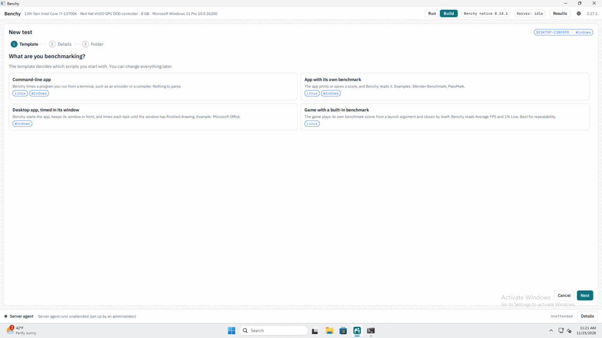

# What an application test is

An application test measures how long a real program takes to do real work in its own window. A person who edits photos does not care how fast a filter runs in a command-line tool. They care how long they wait after they click. An application test starts the program in a visible window, makes it do a list of jobs, and stops the clock on each job only when the window has finished drawing the result.

This page helps you decide whether that is the kind of test you need. It is not always.

## Three ways to benchmark a program

Benchy's wizard asks "What are you benchmarking?" and offers four starting points. Three are relevant to applications.

A command-line app is a program you run from a terminal and time from outside: an encoder, a compiler, a compressor. Benchy starts it, waits for it to finish and records how long it took. If your program can do its job from the command line with the same code the window uses, this is the simplest test to write and the most repeatable. Choose it first if you can.

An app with its own benchmark prints or saves a score, and Benchy reads it. Blender Benchmark and PassMark are the examples on the card. If the vendor already built a benchmark, use it. Your test then only has to install the program, run it and pick the numbers out of its output.

A desktop app, timed in its window, is for programs whose speed is the speed of a person using them, and which have neither a command-line mode that does the same work nor a benchmark of their own. Benchy starts the application, keeps its window in front, and times each task until the window has drawn. It also fails the trial if anyone touches the keyboard or mouse during a task, because a stray click would change what is measured. The card gives Microsoft Office as its example, and PhotoCraft is the second.

## When to write an application test

Write one when all of these are true:

1. The application is the thing people will want to compare machines on, and what they care about is waiting in its window.
2. There is no command-line mode or built-in benchmark that exercises the same work.
3. You can make the application do each task without a person clicking. (The next page is mostly about this, because it decides whether the test will work at all.)
4. You can describe each task so exactly that a script can tell whether it happened.

If the fourth is hard, stop and think. An application test that cannot tell a finished job from one that quietly did nothing will produce fast times that are wrong, and nobody will notice.

## What an application test costs

An application test is more work than the other kinds, and slower to run. The PhotoCraft test installs a 143 MB zip, generates a 480 MB document, and takes five to six minutes for a run of one warm-up trial and three scored trials. It needs a real desktop session on the machine, so it cannot run from a service or over a disconnected remote session. It needs at least 5 GB of free disk and 8 GB of memory. And it is a Windows test: the template's window-timing helpers exist only on Windows today.

What you get for that is a number that means something to the person using the application, produced the same way each time.
