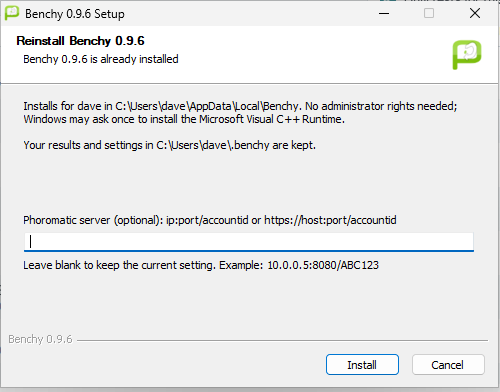

# Installing Benchy

Benchy runs from a folder, so installing it is mostly a matter of getting PHP on the machine and putting the folder somewhere sensible. This page covers Linux and Windows, and ends with a quick check that it works. On Ubuntu and Debian the quickest route is the Debian package that comes with each release, so that is where the Linux section starts. It is written for Benchy 0.9.8.

## Before you start

You need a copy of Benchy 0.9.10. On Ubuntu and Debian that is the package `benchy_0.9.10_all.deb`. On other Linux systems it is a folder (or archive) containing the files `benchy` and `install-sh`. On Windows it is the installer, `Benchy-Setup-0.9.10.exe`, which brings the desktop client (0.10.1) and the native engine (0.3.1) with it. All of these are attached to the releases on the project's GitHub page, [github.com/dakotlyar/benchy](https://github.com/dakotlyar/benchy), under **Releases**. From 0.9.9 on, the Linux desktop client and the Linux engine are attached to every release too (see [below](#the-linux-desktop-client)); for 0.9.8 they were added to that release afterward.

You also need a few gigabytes of free disk space for the tests you download, and an internet connection the first time, because Benchy fetches its list of tests and each test's files from OpenBenchmarking.org. This is a request for files only; see [what Benchy sends out](good-to-know.md#what-benchy-does-and-does-not-send-out).

## Installing on Linux

There are two ways to install Benchy on Linux. On Ubuntu and Debian, use the package: one command installs Benchy and everything it needs. On any other distribution, install PHP yourself and run Benchy from its folder or with `install-sh`.

### On Ubuntu or Debian: the .deb package

The package is the route 0.9.10 was built and checked for, and it was proved on a minimal Ubuntu 26.04 server with no display. It also installs on Ubuntu 24.04 and Debian 13, where only the install and `benchy version` were tried. Debian 12 has not been tried.

1. Download `benchy_0.9.10_all.deb` and `benchy_0.9.10_all.deb.sha256` from the 0.9.10 release on the [Releases page](https://github.com/dakotlyar/benchy/releases).

2. Check that the download is intact. The `.sha256` file holds the checksum the package should have:

        sha256sum -c benchy_0.9.10_all.deb.sha256

   It should print:

        benchy_0.9.10_all.deb: OK

3. Install it with `apt`, giving the path to the file:

        sudo apt update
        sudo apt install ./benchy_0.9.10_all.deb

   Keep the `./` in front of the name. It tells `apt` this is a file and not the name of a package in the archive, and it lets `apt` fetch whatever else the package needs. On a brand-new server, run `apt update` first so that `apt` knows what is available.

4. Check that it works. Do this as yourself, not as root:

        benchy version

   The first command you run fetches Benchy's list of tests, so it prints a long list of tests before the version. It ends with:

        Benchy v0.9.10

What the package brings with it depends on what `apt` is allowed to add.

**A normal install** pulls in PHP and the PHP extensions Benchy uses, a compiler toolchain (`build-essential` and `pkgconf`, because most tests are built on your machine), the archive tools (`tar`, `gzip`, `bzip2`, `xz-utils`, `unzip`) and CA certificates. It also brings four recommended extras:

| Package | What you get from it |
|---|---|
| `php-sqlite3` | The database the Phoromatic server needs. You do not need it to run tests. |
| `php-gd` | PNG and PDF graphs. The SVG graphs in the result viewer do not need it. |
| `pciutils` | `lspci`, so Benchy can name your graphics card, chipset and network card. |
| `iproute2` | The `ip` command, which Benchy uses when it describes the network. |

On a fresh Ubuntu 26.04 container this added 205 packages in all, counting PHP itself and the compilers.

**A lean install** leaves the four extras out:

    sudo apt install --no-install-recommends ./benchy_0.9.10_all.deb

On the same fresh container this added 111 packages. Tests install and run the same way. What you lose is PNG and PDF graph export, the server's database support, and some detail in `benchy system-info`: the graphics line shows only the kernel's name for the display (for example `amdgpudrmfb`), and the chipset, audio and network lines are missing. If you want any of these later, install the package from the table, for example `sudo apt install php-gd`. `php-gd` is the only package in the list that brings in any X11 libraries, and those are shared libraries only, not an X server or a desktop.

The package never starts anything. It puts the Phoromatic server's and the server agent's systemd service files in place but does not enable or start them, so installing Benchy runs nothing until you ask for it. Setting up a Phoromatic server is a job for an administrator, and from 0.9.8 it has a package of its own, `benchy-server`; the [administrator's guide](../admin-guide/new-server.md) walks through it, and you do not need it to run tests or to pair a machine with someone else's server. To remove the package, run `sudo apt remove benchy`. Your settings and results are in your home folder and stay. To upgrade, install the newer `.deb` the same way.

Since 0.9.8 the release carries a second package, `benchy-server_0.9.10_all.deb`. It is for the one machine in a house that runs the Phoromatic server, and it is not needed on a desktop or on any machine that only runs tests or is paired with a server. It adds a service user, the server's settings and a setup command; the [administrator's guide](../admin-guide/new-server.md) explains it.

#### Headless machines

A headless machine is one with no display session and no graphics hardware Benchy can see, meaning no render node under `/dev/dri` and no NVIDIA device. A plain server is headless, and so is a container unless a graphics device has been passed in to it. When a test needs system packages, Benchy also installs a short list of general tools. On Ubuntu and Debian that list used to include the OpenGL and Vulkan information tools (`mesa-utils` and `vulkan-tools`), which on a server pulled in around 130 packages of GTK, Mesa and Wayland libraries that nothing would use. Since 0.9.7 Benchy leaves those two out when the machine is headless. Installing `pts/sysbench` on a minimal Ubuntu 26.04 container added 15 packages: the build tools it lists (`build-essential`, `autoconf`, `libtool`, `libaio-dev`) and `unzip` and `apt-file`, with their libraries.

A desktop you reach over SSH still counts as a desktop, because its graphics hardware is there, and it still gets the tools. If a machine does have a display but Benchy cannot see its graphics (a virtual machine with an emulated graphics card, say), install them yourself with `sudo apt install mesa-utils vulkan-tools`. See [When something goes wrong](troubleshooting.md#opengl-or-vulkan-details-are-missing-on-a-headless-machine).

One more thing a server needs: a normal user account with `sudo`. Benchy asks for your password whenever a test needs a system package, and it should not be run as root (see [Where Benchy keeps things](#where-benchy-keeps-things)).

### On any other Linux distribution

There is no package for other distributions yet. An RPM for Fedora and Red Hat systems has been built but has only been tried on Fedora, and only as far as installing it and running `benchy version`, so it is not released and this guide does not cover it. Use the route below.

Benchy needs only the command-line version of PHP, not a web server. The package is usually called `php-cli` or `php`. It also needs a handful of PHP extensions. The launcher prints the likely command if PHP is missing; for the common families it is:

| Distribution | Command |
|---|---|
| Debian, Ubuntu (without the package above) | `sudo apt-get install php-cli php-xml` |
| Fedora, Red Hat | `sudo dnf install php-cli php-xml php-json` |
| Arch | `sudo pacman -S php` |

Four extensions are required: DOM, ZIP (or zlib), JSON and SimpleXML. Benchy also wants OpenSSL, because it is how it talks to HTTPS servers, including your Phoromatic server. Curl, GD, POSIX and PCNTL are recommended. Each time you start Benchy it lists any that are missing, marked `REQUIRED` or `OPTIONAL`, so you do not have to guess. Most tests are built on your machine, so you also want a C and C++ compiler and `make`.

Then get the Benchy folder (a release archive or a copy of the source) and use one of the two options below. They work on Ubuntu and Debian too, if you would rather not use the package.

#### Option 1: run it from its folder

Unpack Benchy anywhere you like and run it in place:

    cd benchy
    ./benchy version

Nothing is installed system-wide. This is the easiest way to try it. To type just `benchy` from anywhere, add the folder to your `PATH` (for example `export PATH="$PATH:$HOME/benchy"` in your shell's startup file).

One thing to know about older versions: before 0.9.5, Benchy changed into its own folder when it started, so a file you named on its command line had to be given with a full path (`/home/you/ca.pem`), not a relative one (`ca.pem`). From 0.9.5 a relative name is read from the folder you ran Benchy in, for the commands that take a file (`server-trust`, `server-https-set`, `server-caddy-install`). Result names and test names are unaffected.

#### Option 2: install it

From the Benchy folder, run `install-sh` as root to put the `benchy` command in `/usr/bin`:

    sudo ./install-sh

That puts the command in `/usr/bin/benchy`, the program files in `/usr/share/benchy/` and the documentation in `/usr/share/doc/benchy/`. If you cannot or would rather not use root, use Option 1 and add the Benchy folder to your `PATH` instead. (`install-sh` does accept a folder of your own as its first argument. From 0.9.5 it keeps everything inside that folder, but it installs the bash completion and the systemd units only for `/usr` and `/usr/local`; for any other folder it says so and skips them.) The install folder must not contain a space, `&` or `|`; `install-sh` stops with an error if it does.

If `install-sh` prints a line beginning `ERROR:`, it did not replace the `benchy` command you already had. Read the message; it is usually a folder it cannot write to.

To upgrade, unpack the new version and run `./install-sh` again. Your settings and saved results are in your home folder and are not touched.

## Installing on Windows

Run `Benchy-Setup-0.9.10.exe`. The installer works for your user account only, so it does not need administrator rights.

1. Start the installer. The first page names what it is about to do: install, reinstall, upgrade or (after a confirmation) downgrade Benchy.

2. Optionally fill in the **Phoromatic server** field with your server's address, in the form `ip:port/accountid` or, for a server that uses HTTPS, `https://host:port/accountid`. Leave it blank to set that up later; [the Phoromatic server chapter](phoromatic-server.md) explains where the address comes from. The Install button stays greyed out while the text in the box is not a valid address.
3. Click **Install**. Windows may ask once for permission to install the Microsoft Visual C++ Runtime if it is missing or too old. Say yes. If it asks for a restart, restart and run the installer again.
4. On the last page, tick **Open Benchy now** if you like, and click **Finish**.

Benchy goes into `%LOCALAPPDATA%\Benchy`. The installer brings its own copy of PHP, the desktop client, and the native engine (in the install folder under `engine\native`, where the client finds it without being told). It adds Benchy to your `PATH` and creates two Start Menu shortcuts:

| Shortcut | What it opens |
|---|---|
| Benchy | The desktop client (see below). |
| Benchy Command Prompt | A command prompt where the `benchy` command works. |

Open a new terminal after installing, so that it sees the new `PATH`, and use `benchy` exactly as the Linux examples in this guide do. Where a Windows difference matters, the chapters say so.

Installing over an existing Benchy upgrades it and keeps your settings, your results and, if the machine was paired with your Phoromatic server, the pairing. The installer will not run while Benchy is running, and it checks again just before it copies files, so it can also stop a little way in if you opened Benchy while it was working. When it does, it says it stopped before it copied anything of Benchy, the client or the engine, and that the PHP step and the clean-up of any staged update had already run, so a different PHP may be in place. Quit Benchy and run the installer again to finish the job. That includes the desktop client in the tray, and a server agent that was left running in the background with no icon. If the installer stops, quit Benchy first: right-click its tray icon and choose **Quit**. If there is no tray icon, open Benchy from the Start menu, choose Quit and pick **Quit and stop the agent**, then run the installer again. The same goes for the uninstaller. [When something goes wrong](troubleshooting.md#windows) has the exact messages.

The engine keeps its own data (saved native results and the server pairing) in `%LOCALAPPDATA%\benchy-engine`, outside the install folder on purpose, so upgrading and uninstalling both leave it alone. If you retire a paired machine, read [Forget the server before you retire a machine](pair-this-machine.md#forget-the-server-before-you-retire-a-machine) before you uninstall.

The first time you run a test that needs one, Benchy sets up Cygwin (a set of Unix tools) in `C:\cygwin64` and may ask for permission. About a hundred of the tests have Windows versions; the rest are Linux only.

### The desktop client

Benchy Client is a desktop app. On Windows the installer includes it, as version 0.10.1, and the Start Menu shortcut **Benchy** opens it. The client lets you browse the tests, set a test's options, run it with a live progress bar and log, stop it, and upload the result. It does not replace the command line. It drives the same `benchy` underneath, so everything it does is stored in the same `.benchy` folder. This guide describes the command line, which does everything; the client is a friendlier way to do the "find and run" steps. Two things to know: it runs one test at a time, and trusting an HTTPS server for uploads is still done with the `benchy server-trust` command, not in the client ([the Phoromatic server chapter](phoromatic-server.md#1-trust-the-servers-certificate-once)). Pairing a machine so the server can send it work is different, and is done in the client; that is the subject of [Pair this machine](pair-this-machine.md).

The client also lives in the system tray, the row of small icons at the right of the taskbar. Closing its window does not quit it; right-click the tray icon and choose **Quit** for that. [Pair this machine](pair-this-machine.md#the-tray-icon) explains the icon.

### The Linux desktop client

On Linux the client is an AppImage, a single file that you make executable and run, so it needs no installation. Every Benchy release carries it, so on the [Releases page](https://github.com/dakotlyar/benchy/releases) open the release that matches your Benchy version and download the file whose name starts with `BenchyClient-` and ends in `-x86_64.AppImage`. The `.sha256` file with the same name beside it is the checksum to check it against. Then, in the folder you saved it to (replace `<version>` with the number in the name you downloaded):

    sha256sum -c BenchyClient-<version>-x86_64.AppImage.sha256
    chmod +x BenchyClient-<version>-x86_64.AppImage
    ./BenchyClient-<version>-x86_64.AppImage

The client looks for the command-line Benchy (`benchy` on your `PATH`, then `/usr/bin/benchy`) to run tests, so install Benchy as above first. To pair a Linux machine with the server it also needs the native engine, `benchy-engine`, which is a separate download. It is attached to the same Benchy release as the client. Download the file that starts with `benchy-engine-` and ends in `-linux-x64.tar.gz` (or `-linux-arm64.tar.gz` on an ARM machine), along with the matching `.sha256` file to check it against. Unpack it with `tar xzf`; it holds the `benchy-engine` program and a `LICENSE` file. Put `benchy-engine` on your `PATH` (or in `/usr/lib/benchy/engine/`). If the client cannot find an engine it opens the **Benchy engines** dialog, where you can browse for the file. The top bar shows which engine is in use ("Benchy (PHP)" or "Benchy native"). Everything about pairing is in [Pair this machine](pair-this-machine.md#linux-the-terminal-route-and-keeping-the-agent-running).

## Check that it works

On either system, open a terminal and run:

    benchy version

It should print `Benchy v0.9.10`. Then try:

    benchy system-info

This prints what Benchy detected about your machine: processor, graphics, memory, disk, operating system and so on. It does not change anything, so it is a good first check that detection works.

## Where Benchy keeps things

When you run Benchy as an ordinary user, everything it keeps is under `~/.benchy/` (on Windows, `.benchy` in your user folder).

| Path | What is in it |
|---|---|
| `~/.benchy/user-config.xml` | Your settings. |
| `~/.benchy/installed-tests/` | Tests you have installed. |
| `~/.benchy/test-results/` | Saved results, one folder per result. |
| `~/.benchy/download-cache/` | Files downloaded for tests, kept so a reinstall is quick. |

The folders appear when Benchy first needs them, not at install time.

**Do not run benchmarks as root.** When Benchy runs as root it switches to system locations instead (`/var/lib/benchy/` for data and `/etc/benchy.xml` for settings), so you would end up with a second, separate set of tests and results. Run it as yourself. When a test needs a system package, Benchy asks for the root password at that moment.

## Removing Benchy

On Ubuntu and Debian, if you installed the package, run `sudo apt remove benchy` (add `~/.benchy` to what you delete if you also want to drop your results; the PHP and compiler packages `apt` installed alongside stay unless you run `sudo apt autoremove`). On other Linux systems, delete the files `install-sh` listed at the end of its output, and `~/.benchy` if you also want to drop your results. The desktop client AppImage is a single file: delete it. The engine's data, if you used it, is in `~/.local/share/benchy-engine`.

On Windows, use **Apps & Features** (Settings, Apps). Quit Benchy first, as for the installer. The uninstaller removes the program, the client, the engine, its shortcuts and the "start when I log in" entry. By default it keeps your data: your `.benchy` folder (results, settings and installed tests) and the desktop client's own settings in `%LOCALAPPDATA%\Benchy\BenchyClient`, and it lists them when it finishes. Installing Benchy again finds them; if you would rather be rid of them later, delete the `BenchyClient` folder in `%LOCALAPPDATA%\Benchy` by hand, because the uninstaller has removed itself by then. The uninstaller asks whether to delete that data as well; answer yes to remove both, and no (the default) to keep them. A quiet uninstall, which does not ask, keeps them too. To remove them without being asked, run `uninstall.ps1 -RemoveUserData`. The shared Visual C++ Runtime and Cygwin stay, and so does `%LOCALAPPDATA%\benchy-engine` (the engine's results and the server pairing), which the uninstaller lists among the things it kept. If the machine was paired with a server, [forget the server](pair-this-machine.md#forget-the-server-before-you-retire-a-machine) before you uninstall.
