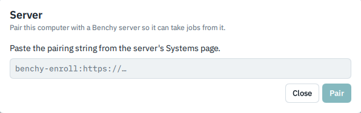
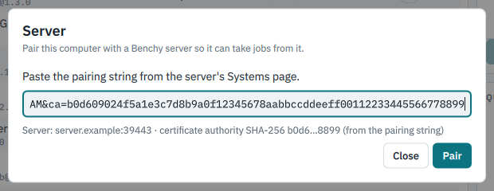
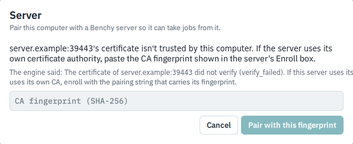
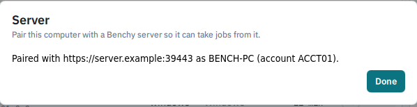
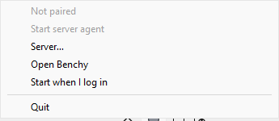
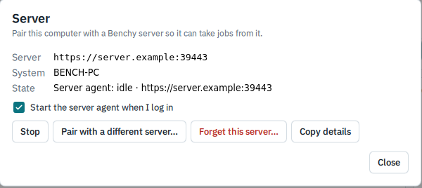
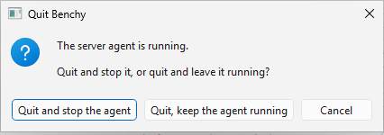

# Pair this machine and let it take scheduled work

Until now this guide has had you run Benchy by hand. This page is about the other way a machine can be used: you pair it with your Phoromatic server once, and from then on a small background program, the server agent, asks the server every minute or so whether there is a benchmark for this machine, runs it, and sends the result back. You do not need a terminal for any of it on Windows. It is written for someone at a desk with a Windows machine (the usual case) or a Linux one, and it covers pairing, what the tray icon tells you, starting at login, quitting, and what to do before you retire a machine. It covers Benchy 0.9.6 with desktop client 0.10.1 and engine 0.3.1.

Pairing is optional. A machine that is never paired works exactly as before, and the older route in [Sending results to your Phoromatic server](phoromatic-server.md) is still there for uploading your own results.

## How it fits together

Three pieces take part:

| Piece | What it does |
|---|---|
| The desktop client | The Benchy window and the tray icon. You pair, start, stop and quit from here. |
| The engine (`benchy-engine`) | Benchy's newer, native test runner. The server agent is part of it. On Windows the installer puts it next to the client, in the install folder under `engine\native`, and the client finds it by itself. |
| Your Phoromatic server | Holds the schedules, hands out jobs and collects results. |

The server agent only works with the native engine, so the tests it runs are the native ones, such as `benchy/stream`. Tests that exist only for the PHP `benchy` command do not run through it. An administrator decides which tests a schedule contains and which of the machines it applies to; you do not choose them.

The agent never runs a job while you are using the machine. If you start your own run, the agent tells the server it is busy and waits until you are done.

## What you need from the administrator

Pairing needs two things from whoever runs your server. Your server approves new machines by hand, so you have to ask; there is no way to do it yourself.

- A **pairing string**. The administrator makes it on the server's Systems page, under "Enroll A Native System", as a one-time enrollment code that is good for 24 hours and works once. The page shows the code, the CA fingerprint and the pairing string once, with a Copy button. The string begins `benchy-enroll:https://` and holds the server address and the code. Treat it like a password until it has been used.
- The **CA fingerprint**, when the server makes its own certificates (yours does). This is a 64-digit SHA-256 value, and it proves you are talking to the real server. It is normally part of the pairing string, in which case the Server dialog shows the first and last four digits of it for you to compare with what the administrator told you. If it is not in the string, the dialog asks you to paste it.

Get the fingerprint from the administrator directly, not over the same network path as the server.

## Pair a machine (desktop client)

1. Open Benchy from the Start menu (Windows) or run the AppImage (Linux; see [Installing Benchy](install.md#the-linux-desktop-client)). The top bar has a small chip at the right that says **Not paired**.
2. Click that chip. The **Server** dialog opens, with the line "Pair this computer with a Benchy server so it can take jobs from it."

3. Paste the pairing string into the box. Under the box Benchy shows what it understood, for example `Server: server.example:39443 · certificate authority SHA-256 b0d6…8899 (from the pairing string)`. Check the server name, and compare the four digits at each end with the fingerprint you were given. If they differ, stop and ask the administrator.

4. Click **Pair**.
5. If the server's certificate is not one this machine already trusts and the string carried no fingerprint, the dialog says "`<server>`'s certificate isn't trusted by this computer. If the server uses its own certificate authority, paste the CA fingerprint shown in the server's Enroll box." A smaller line under it, starting "The engine said:", gives the technical reason. Paste the fingerprint and click **Pair with this fingerprint**. Benchy fetches the server's certificate authority, checks it against what you typed and trusts it for that server only.

6. When it works the dialog says "Paired with `<server>` as `<system name>` (account `<account>`)." Click **Done**. The agent starts by itself, and the chip in the top bar changes from "Not paired" to "Server: idle".

Two lines may follow:

- "The server still has this system on the PHP engine. An admin needs to switch it to native before jobs arrive." The pairing worked, but no job will come until an administrator switches the system on the server. Tell them.
- "`n` unsent item(s) from the previous server were set aside." You were paired with another server before, and results that had not been sent to it were kept aside on your machine, not sent to the new server.

If this machine is already paired and you click **Pair with a different server…**, Benchy tells you that pairing again replaces the old pairing and the machine stops taking jobs from the old server, and asks you to confirm with **Replace**. If the agent is running at that moment it is stopped first (and a job it was running is cancelled; what had finished is uploaded).

## The tray icon

Once Benchy is installed, a small round icon sits in the notification area at the right of the taskbar (on Windows you may need to click the up arrow to see it). Hover over it for a one-line status that starts "Benchy ·". The colour tells you what the agent is doing:

| Icon | Meaning |
|---|---|
| Green | Idle: paired and waiting for work. |
| Blue | Running a job or uploading its result. |
| Amber | Held by the server, paused because you are running tests, can't reach the server and trying again, or stopping. |
| Grey | Stopped, or not paired. |
| Grey with a question mark | Benchy cannot read the agent's state. |
| A red dot on the corner | The agent stopped on its own. |

The same state is written out in words in the Server dialog, under **State**. The ones you will see most are "Server agent: idle · `<server>`", "Running `<job>`, test 2 of 5", "Paused while tests run on this computer", "Can't reach the server; trying again in 30 s" and "Stopped".

Click the icon to open the Benchy window. Right-click it for the menu:

On a paired machine the first line reads "Server agent: idle · `<server>`" and the second says "Stop server agent"; here, before pairing, it says "Not paired" and "Start server agent" is greyed out.

| Menu item | What it does |
|---|---|
| (status line) | The current state, in words. Not clickable. |
| Start server agent / Stop server agent | Starts the agent or stops it. Stopping while it is running a job asks first, because it cancels the job (tests that had finished are uploaded). |
| Cancel server job | Only shown while a server job is running. Cancels it; the server will not restart it for that trigger. |
| Server… | Opens the Server dialog. |
| Open Benchy | Opens the window. |
| Start when I log in | A check mark: see below. |
| Quit | Quits Benchy; see below. |

Closing the Benchy window does not quit it. The window just goes away and Benchy stays in the tray. The first time, a notice tells you "Benchy is still running in the tray. Quit it from the tray icon."

The Server dialog does the same things with buttons once a machine is paired:

Its buttons are **Start** or **Stop**, **Cancel server job**, **Pair with a different server…**, **Forget this server…** and **Copy details** (which puts the technical state on the clipboard, handy when you report a problem).

## What you will see on the server

You do not need the server's web pages to use a paired machine, but they are where its work comes from, so it helps to know what is there. Look at the server in a browser as described in [Sending results to your Phoromatic server](phoromatic-server.md#looking-at-your-results-on-the-server).

- The **Systems** page lists the machine under the name it was paired with, marked "Idle (native agent)" while the agent is waiting for work. This is also where an administrator makes the pairing string, and the page has a **Native Engine** section for each system, with its engine setting and a **Revoke** button that takes the machine's pairing away.
- A **schedule** on the **Testing** menu has a **Native Tests** box for the tests the paired machines run, such as `benchy/stream`, with their options. The box offers only tests that the schedule's own systems told the server they can run, and when a schedule has several systems it says which of them can run each test. A test your machine does not have, or that was added since the agent last said hello, may not be listed until the agent restarts or six hours pass.
- A native result is stored and shown like any other, on the **Results** page and in compare.

If the administrator's pairing string was made while browsing the server by an address its certificate does not cover, the server shows a red warning on the code box, and the machine will refuse the connection. That is why the string has to be made from the right address; see the messages in [When something goes wrong](troubleshooting.md#pairing-and-the-tray).

## Running your own tests while the agent is paired

You can use the Benchy window as before. If a server job is running when you press **Run**, Benchy says "Busy with server job `<job>` (test 2 of 5)" and offers to cancel the server job so you can go first. The tests of that job that had already finished are uploaded. If you start your own run when nothing else is going on, the agent shows "Paused while tests run on this computer" until you finish.

Only one Benchy run can use a machine at a time. See [the run lock](good-to-know.md#one-run-at-a-time-the-run-lock).

## Start at login (Windows)

To have the agent come back after a restart, right-click the tray icon and tick **Start when I log in**, or tick **Start the server agent when I log in** in the Server dialog. When you log in, Benchy then starts in the tray, with no window, and starts the agent. (Behind the scenes Windows is given a login entry named Benchy that runs `BenchyClient.exe --tray` from the install folder.)

This setting is written only by the copy of Benchy that the installer put in `%LOCALAPPDATA%\Benchy`. If you run another copy, such as an unzipped download in your Downloads folder, the check box still works but the login entry is pointed at the installed copy when there is one. If the installed copy is missing and you tick the box from another copy, the entry points at that other copy until the installed one starts again and takes the entry back.

On Linux the client does not offer a login entry. Use the systemd user unit described [below](#linux-the-terminal-route-and-keeping-the-agent-running).

## Quit

Choose **Quit** from the tray menu. If the agent is not running, Benchy simply quits. If it is, a box titled "Quit Benchy" asks:

The buttons are **Quit and stop the agent**, **Quit, keep the agent running** and **Cancel**. If the agent is working on a job, the box says so, and adds that quitting and stopping it cancels the job, with the finished tests uploaded.

Choosing "keep the agent running" leaves a background program with no icon and no window, which keeps taking jobs. That is what you want on a machine nobody sits at, but it surprises people who then cannot find it. To get at it again, start Benchy from the Start menu, then choose Quit and "Quit and stop the agent". The installer also refuses to run while that agent is up (see [When something goes wrong](troubleshooting.md#windows)).

If a run of your own is in progress, Quit first asks "Stop the run and quit?"; its **Stop and quit** button keeps the tests that finished.

## Forget the server before you retire a machine

Do this before you uninstall Benchy, sell the machine, or hand it to someone else.

1. Open the Server dialog (tray menu, **Server…**).
2. Click **Forget this server…**.
3. Read the question: "Forget `<server>`? The agent stops, and this computer no longer takes jobs from that server. The server keeps listing the system until an admin removes or revokes it; forgetting doesn't contact the server." Click **Forget**.
4. Tell the administrator the machine is gone, so they can remove or revoke the system on the server.

The pairing token is kept in `%LOCALAPPDATA%\benchy-engine` (Windows) or `~/.local/share/benchy-engine` (Linux), outside Benchy's install folder on purpose, so that upgrading or reinstalling does not make you pair again. For the same reason **uninstalling Benchy does not remove it**, and neither does the uninstaller's choice to remove your data. Until you forget the server, or an administrator revokes the system, that token is still valid on the server. Forgetting here removes it from the machine; it does not tell the server, so the administrator's revoke is what makes it dead there.

If you want everything gone, forget the server first, then delete the `benchy-engine` folder yourself. It also holds your native results.

## Linux: the terminal route, and keeping the agent running

On Linux the client is an AppImage (see [Installing Benchy](install.md#the-linux-desktop-client)), and the pairing steps above are the same. Linux has no installer, so the client has to find the native engine: it looks for `benchy-engine` on your `PATH`, then `/usr/lib/benchy/engine/benchy-engine`. If neither is there, the **Benchy engines** dialog (click the engine name in the top bar) lets you browse for the file. Download the engine from the Releases page of [github.com/dakotlyar/benchy-engine](https://github.com/dakotlyar/benchy-engine).

You can also pair without the client, from a terminal. The command needs `--json` first, and the pairing string goes in on standard input so that the code is not left in your shell history or visible to other users on the machine:

    echo '["benchy-enroll:https://server.example:39443?code=...&ca=..."]' | benchy-engine --json agent enroll --json-args -

The output is JSON, one event per line, ending with `"status":"ok"` when pairing worked. Run `benchy-engine --json agent status` to see the state and `benchy-engine --json agent forget` to forget the server. Without `--json`, `benchy-engine agent enroll` prints only a usage line and does nothing.

To keep the agent running on Linux, use the systemd user unit that comes with the engine (`packaging/systemd/benchy-agent.service` in the engine's source; the comments at the top say how to install it). The client does not start or stop the agent when that unit is installed; it says "Started by systemd (benchy-agent.service, ...). Benchy doesn't start, restart or enable it." Where the desktop has no system tray, the Server dialog says so, and recommends the same unit.

## What goes wrong

The messages are listed in [When something goes wrong](troubleshooting.md#pairing-and-the-tray).
