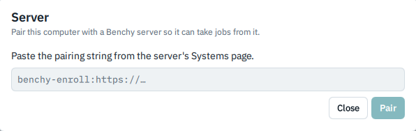
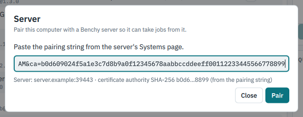
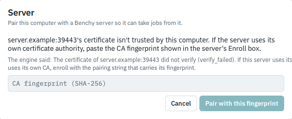
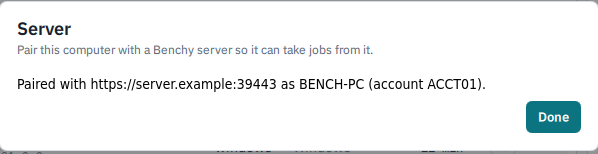
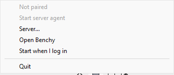
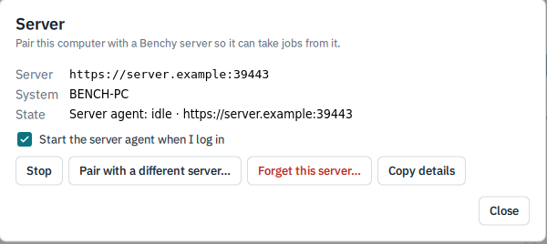
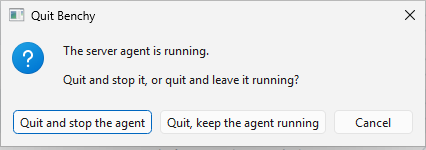

# Pair this machine and let it take scheduled work

Until now this guide has had you run Benchy by hand. This page is about the other way a machine can be used: you pair it with your Phoromatic server once, and from then on a small background program, the server agent, asks the server every minute or so whether there is a benchmark for this machine, runs it, and sends the result back. You do not need a terminal for any of it on Windows. It is written for someone at a desk with a Windows machine (the usual case) or a Linux one, and it covers pairing, what the tray icon tells you, starting at login, quitting, and what to do before you retire a machine. It covers the machine side as it will be in 0.10.1, with engine 0.8.0 and desktop client 0.11.0. Benchy 0.10.0 is a server release and does not include them, so until 0.10.1 the join code, **Find servers**, the approval and unattended setups and the **Upload** action described below are not on your machine. A machine with the 0.9.15 installer (engine 0.6.0, client 0.10.2) pairs with a pairing string and works with a 0.10.0 server as it did before.

Pairing is optional. A machine that is never paired works exactly as before, and the older route in [Sending results to your Phoromatic server](phoromatic-server.md) is still there for uploading your own results.

## How it fits together

Three pieces take part:

| Piece | What it does |
|---|---|
| The desktop client | The Benchy window and the tray icon. You pair, start, stop and quit from here. |
| The engine (`benchy-engine`) | Benchy's newer, native test runner. The server agent is part of it. On Windows the installer puts it next to the client, in the install folder under `engine\native`, and the client finds it by itself. |
| Your Phoromatic server | Holds the schedules, hands out jobs and collects results. |

The server agent only works with the native engine, so the tests it runs are the native ones, such as `benchy/stream`. Tests that exist only for the PHP `benchy` command do not run through it. An administrator decides which tests a schedule contains and which of the machines it applies to; you do not choose them.

The agent never runs a job while you are using the machine. If you start your own run, the agent tells the server it is busy and waits until you are done.

## What you need from the administrator

Pairing needs something from whoever runs your server, so you have to ask them; you cannot make it yourself. There is no separate approval afterwards: the one-time code is the approval, and the machine is ready as soon as it has used it. The administrator makes the code on the server's Systems page, under "Enroll A Native System", and can give you either of two things.

- A **join code**: ten characters such as `K7Q-29X-A1FH`. It is short enough to type or read over the phone, works once and lasts an hour. Capital letters and small letters are the same, the dashes are optional, and Benchy reads `I` and `L` as the digit 1 and `O` as the digit 0, so a small slip between look-alike characters does not matter. The last four characters are a check made from the server's identity, so Benchy can tell on your computer whether the code belongs to the server you are about to contact, before it sends anything. This is the easiest way when you are standing at the machine.
- A **pairing string**: a long line that begins `benchy-enroll:https://` and holds the server address, the code and the server's certificate fingerprint. It works once and lasts 24 hours. Treat it like a password until it has been used. Use it when the server cannot be found on your network or an administrator is pairing a machine for you.

With a pairing string the server's **CA fingerprint** is normally part of it. This is a 64-digit SHA-256 value that proves you are talking to the real server, and the Server dialog shows its first and last four digits for you to compare with what the administrator told you. If the string does not carry it, the dialog asks you to paste it. Get the fingerprint from the administrator directly, not over the same network path as the server. A join code needs no fingerprint, because the code itself is tied to the server.

## Pair a machine (desktop client)

1. Open Benchy from the Start menu (Windows) or run the AppImage (Linux; see [Installing Benchy](install.md#the-linux-desktop-client)). The top bar has a small chip at the right that says **Not paired**.
2. Click that chip. The **Server** dialog opens, with the line "Pair this computer with a Benchy server so it can take jobs from it."

3. Look at **Servers on your network**. Press **Find servers** (it becomes **Search again** afterwards) and Benchy looks for a few seconds. Each server it finds is listed with its name and address, and a line saying how it was found. If your administrator has named a server for every machine, or the installer left a suggestion, that one is listed first. A server on another part of your network (another VLAN) is found only if your administrator added a DNS record for it; if the list stays empty the dialog says so, and you can press **Type an address instead**, type `host` or `https://host:port`, and press **Check**. Everything in the list is only a suggestion that anyone on the network could have made up. Picking a server trusts nothing until you pair.
4. Type the join code into the box, or paste the pairing string. Under the box Benchy tells you what it understood.
   - For a join code it says "A join code. It is checked against `<server>` before anything is sent." (or "matched against the servers found", when you have not picked one). If the code does not belong to that server, Benchy stops with a message and sends nothing; see [When something goes wrong](troubleshooting.md#pairing-and-the-tray).
   - For a pairing string it shows, for example, `Server: server.example:39443 · certificate authority SHA-256 b0d6…8899 (from the pairing string)`. Check the server name, and compare the four digits at each end with the fingerprint you were given. If they differ, stop and ask the administrator.

(The picture is from before the list of servers was added. The box and the line under it are the same.)

5. Click **Pair**. If the server's certificate is not one this machine already trusts and the string carried no fingerprint, the dialog says "`<server>`'s certificate isn't trusted by this computer. If the server uses its own certificate authority, paste the CA fingerprint shown in the server's Enroll box." A smaller line under it, starting "The engine said:", gives the technical reason. Paste the fingerprint and click **Pair with this fingerprint**. Benchy fetches the server's certificate authority, checks it against what you typed and trusts it for that server only.

6. When it works the dialog says "Paired with `<server>` as `<system name>` (account `<account>`)." Click **Done**. The agent starts by itself, and the chip in the top bar changes from "Not paired" to "Server: idle".

On the first start of a machine that is not paired, Benchy may also show a card at the top of the **Run tests** page: "Benchy found a server on your network: `<name>` (`<address>`)." with **Pair with it…**, **Not now** and **Use this computer on its own**. **Pair with it…** opens the Server dialog with that server picked; it still asks for a code. **Use this computer on its own** stops the card from coming back.

Two lines may follow:

- "The server still has this system on the PHP engine. An admin needs to switch it to native before jobs arrive." The pairing worked, but no job will come until an administrator switches the system on the server. Tell them.
- "`n` unsent item(s) from the previous server were set aside." You were paired with another server before, and results that had not been sent to it were kept aside on your machine, not sent to the new server.

If this machine is already paired and you click **Pair with a different server…**, Benchy tells you that pairing again replaces the old pairing and the machine stops taking jobs from the old server, and asks you to confirm with **Replace**. If the agent is running at that moment it is stopped first (and a job it was running is cancelled; what had finished is uploaded).

## The tray icon

Once Benchy is installed, a small round icon sits in the notification area at the right of the taskbar (on Windows you may need to click the up arrow to see it). Hover over it for a one-line status that starts "Benchy ·". The colour tells you what the agent is doing:

| Icon | Meaning |
|---|---|
| Green | Idle: paired and waiting for work. |
| Blue | Running a job or uploading its result. |
| Amber | Held by the server, paused because you are running tests, can't reach the server and trying again, or stopping. |
| Grey | Stopped, or not paired. |
| Grey with a question mark | Benchy cannot read the agent's state. |
| A red dot on the corner | The agent stopped on its own. |

The same state is written out in words in the Server dialog, under **State**. The ones you will see most are "Server agent: idle · `<server>`", "Running `<job>`, test 2 of 5", "Paused while tests run on this computer", "Can't reach the server; trying again in 30 s" and "Stopped".

Click the icon to open the Benchy window. Right-click it for the menu:

On a paired machine the first line reads "Server agent: idle · `<server>`" and the second says "Stop server agent"; here, before pairing, it says "Not paired" and "Start server agent" is greyed out.

| Menu item | What it does |
|---|---|
| (status line) | The current state, in words. Not clickable. |
| Start server agent / Stop server agent | Starts the agent or stops it. Stopping while it is running a job asks first, because it cancels the job (tests that had finished are uploaded). |
| Cancel server job | Only shown while a server job is running. Cancels it; the server will not restart it for that trigger. |
| Server… | Opens the Server dialog. |
| Open Benchy | Opens the window. |
| Start when I log in | A check mark: see below. |
| Quit | Quits Benchy; see below. |

Closing the Benchy window does not quit it. The window just goes away and Benchy stays in the tray. The first time, a notice tells you "Benchy is still running in the tray. Quit it from the tray icon."

The Server dialog does the same things with buttons once a machine is paired:

Its buttons are **Start** or **Stop**, **Cancel server job**, **Pair with a different server…**, **Forget this server…** and **Copy details** (which puts the technical state on the clipboard, handy when you report a problem).

## What you will see on the server

You do not need the server's web pages to use a paired machine, but they are where its work comes from, so it helps to know what is there. Look at the server in a browser as described in [Sending results to your Phoromatic server](phoromatic-server.md#looking-at-your-results-on-the-server).

- The **Systems** page lists the machine under the name it was paired with, marked "Idle (native agent)" while the agent is waiting for work. This is also where an administrator makes the pairing string, and the page has a **Native Engine** section for each system, with its engine setting and a **Revoke** button that takes the machine's pairing away.
- A **schedule** on the **Testing** menu has a **Native Tests** box for the tests the paired machines run, such as `benchy/stream`, with their options. The box offers only tests that the schedule's own systems told the server they can run, and when a schedule has several systems it says which of them can run each test. A test your machine does not have, or that was added since the agent last said hello, may not be listed until the agent restarts or six hours pass.
- A native result is stored and shown like any other, on the **Results** page and in compare.

If the administrator's pairing string was made while browsing the server by an address its certificate does not cover, the server shows a red warning on the code box, and the machine will refuse the connection. That is why the string has to be made from the right address; see the messages in [When something goes wrong](troubleshooting.md#pairing-and-the-tray).

## Scheduled tests that need administrator rights

A few tests in the signed catalog install a product for every user of the computer, or run as administrator (the server's schedule page and the catalog list in Benchy mark them "Installs ... for all users" and "Runs as administrator"). Windows only lets a program do that with administrator approval, so Benchy never does it quietly. From 0.10.1, with client 0.11.0 and engine 0.8.0, a paired Windows machine can run them in one of two ways, and which one applies is shown in the **Server** dialog next to **Administrator tests**.

### Asking you at the desk

This is how every paired machine works until someone sets up the other way. When a scheduled run holds an administrator test, the tray tells you "A scheduled benchmark needs administrator approval", the top bar chip says "Server: needs approval", and the **Approval** dialog opens (the tray menu has **Approve scheduled run…** if you closed it). It is titled "A scheduled benchmark needs your approval" and lists the tests it will run, how many times, and how many Windows prompts to expect: once to install the product, once for the run, or both. It also says how many minutes are left to answer.

- **Approve** starts the run. Windows then shows its own administrator prompt. If the prompt does not come to the front, look for its blinking button on the taskbar. Say yes, and the run goes ahead; the agent keeps using the machine until it is done.
- **Not now** puts the run off and nothing runs. It is offered again later. When it is ready again the dialog is titled "Ready to run a scheduled benchmark now?" and shows each waiting run with a **Ready** mark, and you press **Approve** when you are ready to be interrupted.

The first time a particular test version is scheduled on the machine, someone has to accept it once, as well. Benchy says "A scheduled benchmark needs you to accept `<test>` once." and the tray offers **Review and accept…**. The **Accept a scheduled test** dialog shows what the test or its installer is and what it will do; press **Accept**, and Windows asks for administrator approval once. The dialog then says "Accepted. The server can send the run now." The same can be done at a terminal with `benchy-engine machine-accept TEST@VERSION`, which prints what it is accepting and the digest to confirm. A new version of the test is asked for again.

Nothing here runs without you: an unanswered approval simply waits, and the server shows the schedule as waiting for this machine, not as failed.

### Running without asking: unattended

On a machine nobody sits at, such as a bench rig, asking at the desk would hold every run forever. An administrator of the machine can set it up once so that the server agent starts at log on already running as administrator, and runs the tests that were accepted without asking. Ordinary tests still run with a standard-user token, so only the tests that need it ever get administrator rights, and the agent's own files are in a folder only administrators can change.

In the **Server** dialog press **Run administrator tests without asking…** and choose whose account the agent should run as: **This account**, or **Another account** and its name. A dedicated local account is the better choice on a bench machine. The dialog says that Windows will ask for administrator approval, then **Set up** does the work and ends with "Done." The same thing from a terminal, as administrator and without `--json`:

    benchy-engine agent setup-elevated --logon-task --user BENCHACCOUNT

Other forms: without `--logon-task` the command only records that scheduled administrator tests may run on a machine whose agent already runs as administrator (User Account Control turned off, or the built-in Administrator account); `--update` brings the protected copy of the engine up to the installed version (the dialog's **Update it…** button; `--now` stops the agent at once instead of waiting until it is idle), `--rollback` undoes an update, and `--undo` removes the setup (the dialog's **Stop running unattended…**, which says the agent then runs from the tray again and asks before each administrator test). Setup is Windows only in this release.

While a machine runs unattended, the tray does not start or stop the agent, the pairing buttons are off, and the Server dialog says "The unattended agent holds this computer's pairing." The Server dialog's line for the machine reads "Run without asking. An administrator set this computer up for that."

If a machine says "This computer isn't set up to run administrator tests without asking" or "The unattended setup on this computer isn't protected any more", run the setup again as described. "The administrator tests policy on this computer can't be read" means the `Benchy Policy\policy.toml` file under Program Files needs an administrator's attention.

## Sending your own results to the server

The desktop client can send the results of your own runs to the server you are paired with. After a run, **Upload last result** on the **Run tests** page sends it, and **Saved results** (the **Results** button in the top bar) lists every native result on this computer, with its state:

| State shown | What it means |
|---|---|
| Not uploaded | Saved here only. **Upload** sends it. |
| Uploaded | The server has it. |
| Sent by its schedule | A server job produced it and the agent already delivered it. |
| Waiting for approval | The server has not approved this computer yet. An administrator has to approve it on the server's Systems page; the result stays queued and is sent after that. |
| Waiting to send: ... | Something is in the way (a run is in progress, or the server could not be reached). Benchy tries again by itself; **Try now** tries at once. |
| Waiting for the server to take results from this computer | The server is too old for this feature. The result is kept here and is retried when you press **Try now**, and about once a day. |
| Refused: ... | The server turned it down for good, with the reason. |

**Upload all not uploaded** sends everything that has not gone yet. **Open** shows a result on the server once it has been uploaded. The client only sends the runs of this computer, and a run that has no finished test is not sent.

**This needs client 0.11.0 and engine 0.8.0, which come in 0.10.1.** The 0.10.0 server already accepts results sent this way. Until your machine has them, nothing sends to it, and an older client, or a server older than 0.10.0, shows "Waiting for the server to take results from this computer" and keeps the result safely on your machine. Nothing is lost. Results from the PHP engine are not affected: **Upload** sends them as before (see [Sending results to your Phoromatic server](phoromatic-server.md)). Native results that a server job produced are still delivered by the agent.

On a machine that runs unattended, the dialog says "This computer's server agent runs unattended, and it isn't set up to send your own results." A separate, upload-only credential for that case is planned for a later release, and the message's mention of **Update** in the Server dialog does not apply yet: nothing there allows it today.

## Running your own tests while the agent is paired

You can use the Benchy window as before. If a server job is running when you press **Run**, Benchy says "Busy with server job `<job>` (test 2 of 5)" and offers to cancel the server job so you can go first. The tests of that job that had already finished are uploaded. If you start your own run when nothing else is going on, the agent shows "Paused while tests run on this computer" until you finish.

Only one Benchy run can use a machine at a time. See [the run lock](good-to-know.md#one-run-at-a-time-the-run-lock).

## Start at login (Windows)

To have the agent come back after a restart, right-click the tray icon and tick **Start when I log in**, or tick **Start the server agent when I log in** in the Server dialog. When you log in, Benchy then starts in the tray, with no window, and starts the agent. (Behind the scenes Windows is given a login entry named Benchy that runs `BenchyClient.exe --tray` from the install folder.)

This setting is written only by the copy of Benchy that the installer put in `%LOCALAPPDATA%\Benchy`. If you run another copy, such as an unzipped download in your Downloads folder, the check box still works but the login entry is pointed at the installed copy when there is one. If the installed copy is missing and you tick the box from another copy, the entry points at that other copy until the installed one starts again and takes the entry back.

On Linux the client does not offer a login entry. Use the systemd user unit described [below](#linux-the-terminal-route-and-keeping-the-agent-running).

## Quit

Choose **Quit** from the tray menu. If the agent is not running, Benchy simply quits. If it is, a box titled "Quit Benchy" asks:

The buttons are **Quit and stop the agent**, **Quit, keep the agent running** and **Cancel**. If the agent is working on a job, the box says so, and adds that quitting and stopping it cancels the job, with the finished tests uploaded.

Choosing "keep the agent running" leaves a background program with no icon and no window, which keeps taking jobs. That is what you want on a machine nobody sits at, but it surprises people who then cannot find it. To get at it again, start Benchy from the Start menu, then choose Quit and "Quit and stop the agent". The installer also refuses to run while that agent is up (see [When something goes wrong](troubleshooting.md#windows)).

If a run of your own is in progress, Quit first asks "Stop the run and quit?"; its **Stop and quit** button keeps the tests that finished.

## Forget the server before you retire a machine

Do this before you uninstall Benchy, sell the machine, or hand it to someone else.

1. Open the Server dialog (tray menu, **Server…**).
2. Click **Forget this server…**.
3. Read the question: "Forget `<server>`? The agent stops, and this computer no longer takes jobs from that server. The server keeps listing the system until an admin removes or revokes it; forgetting doesn't contact the server." Click **Forget**.
4. Tell the administrator the machine is gone, so they can remove or revoke the system on the server.

The pairing token is kept in `%LOCALAPPDATA%\benchy-engine` (Windows) or `~/.local/share/benchy-engine` (Linux), outside Benchy's install folder on purpose, so that upgrading or reinstalling does not make you pair again. For the same reason **uninstalling Benchy does not remove it**, and neither does the uninstaller's choice to remove your data. Until you forget the server, or an administrator revokes the system, that token is still valid on the server. Forgetting here removes it from the machine; it does not tell the server, so the administrator's revoke is what makes it dead there.

If you want everything gone, forget the server first, then delete the `benchy-engine` folder yourself. It also holds your native results.

## Linux: the terminal route, and keeping the agent running

On Linux the client is an AppImage (see [Installing Benchy](install.md#the-linux-desktop-client)), and the pairing steps above are the same. Linux has no installer, so the client has to find the native engine: it looks for `benchy-engine` on your `PATH`, then `/usr/lib/benchy/engine/benchy-engine`. If neither is there, the **Benchy engines** dialog (click the engine name in the top bar) lets you browse for the file. Download the engine from the Benchy release that matches your version, on the [Releases page](https://github.com/dakotlyar/benchy/releases): the file that starts with `benchy-engine-` and ends in `-linux-x64.tar.gz` (or `-linux-arm64.tar.gz` on an ARM machine), along with its `.sha256` file to check it against. [Installing Benchy](install.md#the-linux-desktop-client) has the details. Unpack it with `tar xzf` and put the `benchy-engine` file in one of those two places.

You can also pair without the client, from a terminal. The command needs `--json` first, and the pairing string goes in on standard input so that the code is not left in your shell history or visible to other users on the machine:

    echo '["benchy-enroll:https://server.example:39443?code=...&ca=..."]' | benchy-engine --json agent enroll --json-args -

A join code goes the same way, either alone, when the server can be found on your network, or with the server's address:

    echo '["--join-code","K7Q-29X-A1FH"]' | benchy-engine --json agent enroll --json-args -
    echo '["https://server.example:39443","--join-code","K7Q-29X-A1FH"]' | benchy-engine --json agent enroll --json-args -

A join code is not secret the way a pairing string is (it is useless to any server but the right one), but it is still a one-time key to your server's account, so the same habit applies. To see which servers your computer can find, without pairing: `benchy-engine --json discover` prints one line per server, with how it was found and whether it takes join codes. `--address HOST[:PORT]` checks one address, `--timeout 3s` changes how long it looks, and `--no-mdns` or `--no-dns` leaves a method out.

The output is JSON, one event per line, ending with `"status":"ok"` when pairing worked. Run `benchy-engine --json agent status` to see the state and `benchy-engine --json agent forget` to forget the server. Without `--json`, `benchy-engine agent enroll` prints only a usage line and does nothing.

To keep the agent running on Linux, use the systemd user unit that comes with the engine (`packaging/systemd/benchy-agent.service` in the engine's source; the comments at the top say how to install it). The client does not start or stop the agent when that unit is installed; it says "Started by systemd (benchy-agent.service, ...). Benchy doesn't start, restart or enable it." Where the desktop has no system tray, the Server dialog says so, and recommends the same unit.

## What goes wrong

The messages are listed in [When something goes wrong](troubleshooting.md#pairing-and-the-tray).
