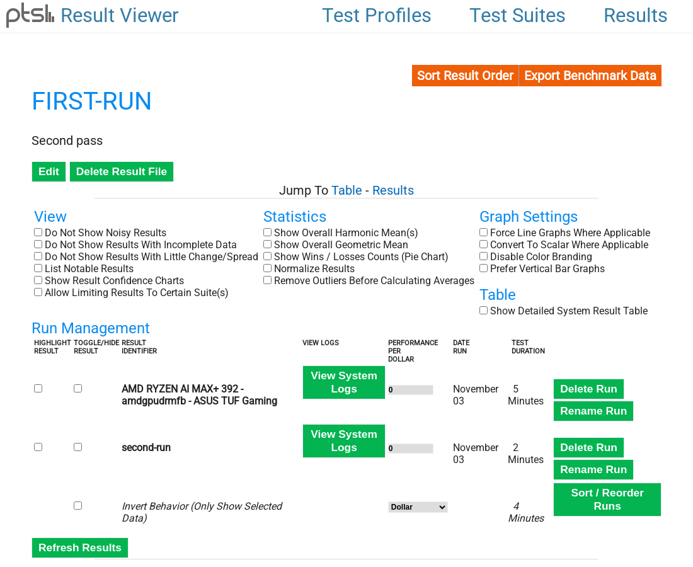

# Reading and comparing results

A benchmark number means little on its own. It becomes useful when you put it beside another one: the same machine before and after a change, or two machines side by side. This page shows how to look at a saved result, how to add a second run and compare, and how to export a result as text, HTML or a spreadsheet.

## What a result holds

A *result* is one saved folder in `~/.benchy/test-results/`. Inside it, Benchy keeps the numbers from each run, the system information (hardware and software) captured at the time, and your name and description for it. A result can hold several *runs*, each with its own label, such as `stock` and `after-bios-update`. The graphs put the runs of one result side by side.

List the results on this machine with:

    benchy list-saved-results

    2 Saved Results

    kitchen-laptop kitchen-laptop
        - stock
        - after-bios-update

## Looking at a result

### In the terminal

    benchy result-file-to-text kitchen-laptop

This prints the title, description, the hardware and software of each run, and then each test as a small bar chart:

    Sysbench 1.0.20
    Test: CPU
    Events Per Second > Higher Is Better
    stock .............. 71100.02 |==============
    second-run ......... 71255.36 |==============

The line under the test name says which way is better. "Higher Is Better" is normal for speeds and scores; time-based tests say "Lower Is Better".

### In a browser

    benchy show-result kitchen-laptop

opens the result in Benchy's own result viewer in your web browser, with graphs and the system details for each run. If you only want to start the viewer without opening a particular result, use `benchy start-result-viewer`:

    Result Viewer: http://localhost:8189
    Press any key when done accessing the viewer to end the process...

The address and port are shown on the first line (the port is chosen at random each time). The viewer answers only to the machine it runs on, so you cannot reach it from another computer, and it stops when you press a key in that terminal.

The page for a result lists its runs under **Run Management**, where you can rename or delete a run, and has tick boxes for noisy results, statistics such as overall means and a wins-and-losses chart, and graph settings. Scroll down for one graph per test. The page also links to exports of the result as text, HTML and PDF.

## Compare two runs

The simplest comparison is two runs in one result. To make the second run, give `benchmark` the *name of the saved result* instead of a test name. Benchy runs the same tests, with the same options, and adds the new run to that result. Use environment variables to give the new run its label without a prompt:

    TEST_RESULTS_NAME=kitchen-laptop TEST_RESULTS_IDENTIFIER=after-bios-update \
      benchy benchmark kitchen-laptop

Benchy shows the labels already in the result and the one it will use:

    Current Test Identifiers:
    - stock

    Test Identifier: after-bios-update

When it finishes, it prints the bar chart with both runs one above the other, as above. That chart, or `benchy show-result`, is the comparison.

A few more ways to see it:

| Command | What it shows |
|---|---|
| `benchy wins-and-losses kitchen-laptop` | A tally of how many tests each run won and lost, with percentages. (`result-file-stats` printed the same summary when tried.) |
| `benchy compare-results-two-way kitchen-laptop` | Lists the runs in the result, asks you to pick two, and compares just those head to head. |
| `benchy result-file-confidence kitchen-laptop` | The spread of each measurement, so you can see which differences are bigger than the noise. |
| `benchy executive-summary kitchen-laptop` | A plain-text summary that points out the prominent differences. |

### Do not trust a small difference

Every benchmark varies a little from run to run. Benchy reports the *deviation* next to each average; a difference between two runs that is smaller than that is noise. If a result matters, run it again, and keep the rest of the machine quiet while it runs (same power mode, nothing else open). Differences of a few percent between two ordinary runs are normal.

### Two different machines

Run the same test on each machine, with the same options, saving into a result of the same name on each. Then bring them together on one of them with `merge-results`:

    benchy merge-results laptop-result desktop-result

It writes a new result with a made-up name such as `merge-3583` (the name is printed, and `benchy list-saved-results` shows it) holding the runs of both, and prints the combined chart. Give the runs different labels before you merge, or you will end up with two runs that look the same. Or, if both machines send their results to your Phoromatic server, compare them there: see [Sending results to your Phoromatic server](phoromatic-server.md#looking-at-your-results-on-the-server). The server's pages have a compare view built for this.

### Against a result on OpenBenchmarking.org

If someone has published a result on openbenchmarking.org, you can run the same tests on your machine and compare directly by giving `benchmark` the result's ID:

    benchy benchmark 1204293-BY-PHORONIX357

Benchy fetches the result's list of tests and options, runs them and places your numbers beside the published ones. It asks before it uploads anything of yours, as usual.

## Export

| Command | Produces |
|---|---|
| `benchy result-file-to-html kitchen-laptop` | One self-contained HTML page with the graphs inlined. Good for emailing. |
| `benchy result-file-to-csv kitchen-laptop` | A CSV file you can open in a spreadsheet. |
| `benchy result-file-to-json kitchen-laptop` | The basic result data as JSON. |
| `benchy result-file-to-pdf kitchen-laptop` | A PDF report. |

Each prints `Saved Output To: <path>`. By default the file goes in your home folder, named after the result. Set `OUTPUT_DIR` (and, if you like, `OUTPUT_FILE`) to put it elsewhere:

    OUTPUT_DIR=/tmp benchy result-file-to-html kitchen-laptop

## Tidying results

| Command | What it does |
|---|---|
| `benchy rename-identifier-in-result-file <result>` | Change a run's label. |
| `benchy remove-run-from-result-file <result>` | Delete one run from a result (it asks which). |
| `benchy remove-result-from-result-file <result>` | Drop one test from a result. |
| `benchy edit-result-file <result>` | Change the result's title and description. |
| `benchy remove-result <result>` | Delete the whole saved result. This cannot be undone. |

All of these ask which run or test you mean, so there is no need to remember the labels.
