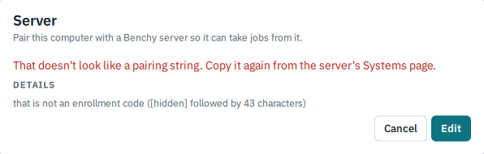
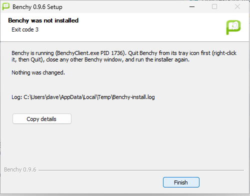

# When something goes wrong

This page lists messages people actually meet, what they mean and what to do. It ends with a list of things Benchy 0.9.9 is known not to do well, so you can tell a limitation from a mistake.

## Starting Benchy

### PHP must be installed for Benchy

The `benchy` launcher cannot find PHP. Install the command-line PHP package (`php-cli` or `php`) with the command the message prints, then try again. See [Installing Benchy](install.md#installing-on-linux).

### To run Benchy locally you must first change directories to benchy/

This is what a copy of Benchy installed by the 0.9.1 `install-sh` printed instead of working. It is fixed. If you see it from an installed `benchy`, run `./install-sh` from the current Benchy folder to replace the broken launcher, then check with `cd / && benchy version`, which should print `Benchy v0.9.9`. If you see the message when you start `./benchy` yourself, you are not in the Benchy folder.

### ERROR: ... is not writable (from install-sh)

`install-sh` puts files under `/usr` by default, which needs root. Run it with `sudo`, or skip the install and [run Benchy from its folder](install.md#option-1-run-it-from-its-folder).

### MISSING ... OPTIONAL (a table of PHP extensions at start-up)

Benchy lists PHP extensions it did not find. `REQUIRED` ones must be installed before it works. The `OPTIONAL` ones only switch off features: no GD means plainer graphs, no PCNTL means some tests and threaded features are unavailable, and no OpenSSL means no HTTPS, so no connection to your Phoromatic server. If you plan to use one, install OpenSSL support first.

On Ubuntu and Debian with the Benchy package, expect to see `Bzip2` listed as missing every time, whichever way you installed. It is harmless: Benchy uses the `bzip2` program for archives, and the extension only affects how much a few files compress. After a `--no-install-recommends` install the table also lists `GD` and `SQLite3`; see [below](#benchy-runs-but-has-no-sqlite3-or-gd-after-a-lean-install).

## The Debian package

### dpkg: dependency problems - leaving unconfigured

You installed the package with `sudo dpkg -i benchy_0.9.9_all.deb`. `dpkg` unpacks a file but does not fetch anything, so on a machine without PHP it stops with lines like these and leaves Benchy half installed:

    dpkg: error processing package benchy (--install):
     dependency problems - leaving unconfigured

    benchy depends on php-cli; however:
     Package php-cli is not installed.

Ask `apt` to finish the job, which fetches what is missing:

    sudo apt -f install

From then on, install Benchy with `sudo apt install ./benchy_0.9.9_all.deb`, as in [Installing Benchy](install.md#on-ubuntu-or-debian-the-deb-package). On a fresh Ubuntu 26.04 container `apt -f install` finished the install and `benchy version` then printed `Benchy v0.9.9`.

### The checksum does not match

`sha256sum -c benchy_0.9.9_all.deb.sha256` printed `FAILED` instead of `OK` (and `WARNING: 1 computed checksum did NOT match`). The download is damaged or is not the file the checksum belongs to. Download both files again from the same release, and keep them in the same folder. Do not install a package that fails the check.

### Error: Unable to locate package benchy_0.9.9_all.deb

You left off the `./`, so `apt` looked for a package of that name in the archive. Write `sudo apt install ./benchy_0.9.9_all.deb`, or give the full path to the file.

### Benchy runs but has no SQLite3 or GD after a lean install

You installed with `--no-install-recommends`. At the start of a command such as `benchy install pts/sysbench`, Benchy lists what it did not find:

    MISSING GD        OPTIONAL -  The GD library is recommended for improved graph rendering.
    MISSING SQLite3   OPTIONAL -  SQLite3 is required when running a Phoromatic server.

Tests install and run normally without them. Install the one you want:

    sudo apt install php-gd         # PNG and PDF graph export
    sudo apt install php-sqlite3    # needed only to run the Phoromatic server

If you start the Phoromatic server without SQLite3, it stops with `PHP SQLite3 support must first be enabled before accessing the Phoromatic server`. Exporting a result to PDF without GD says `PHP GD support and TTF support are required for the PDF output if wanting to display the benchmark result graphs.` (These two messages come from Benchy's source; they were not triggered on the test container.)

### benchy system-info shows less than it should

On a lean install the graphics line shows the kernel's name for the display (for example `amdgpudrmfb`) instead of the card, and the chipset, audio and network lines are missing. Benchy gets those from `lspci` and `ip`. Install them with `sudo apt install pciutils iproute2`.

### OpenGL or Vulkan details are missing on a headless machine

Since 0.9.7, when Benchy installs a test's system packages on a machine with no display and no graphics hardware it can see, it skips `mesa-utils` (which provides `glxinfo`) and `vulkan-tools`. This is deliberate: on a server they would add about 120 packages of desktop libraries. A test's own requirements are still installed. What you can miss is the OpenGL and Vulkan information that Benchy reads from `glxinfo` and `vulkaninfo`. If you have a graphics card or an emulated one that Benchy does not see, and want that information in your results, install the tools by hand:

    sudo apt install mesa-utils vulkan-tools

A desktop you reach over SSH does not need this, because its graphics hardware is visible and it gets the tools automatically. A Docker container counts as headless unless you pass a graphics device in, for example with `--device /dev/dri`. (Benchy prints no message about skipping them, and this page's wording about results with and without them comes from the source and the release notes, not from a graphics test run on a headless machine.)

## Running tests

### There are dependencies still missing from the system

Benchy tried to install a test's system packages and could not. It offers four choices: ignore and carry on (the test will probably fail to build), skip the tests that need the missing packages, try again, or quit. Read the lines above the choices to see which packages failed, install them yourself with your package manager, then choose "try again". Package installs need root, so Benchy asks for the root or `sudo` password when it runs them.

### An answer is required but standard input is closed; exiting

Benchy wanted to ask a question and there was nobody to answer, as happens in a `cron` job, a CI job, or a command with its input redirected from `/dev/null`. Either run it in a terminal, or answer the questions in advance. [Running without questions](finding-and-running-tests.md#running-without-questions) shows how.

### Phoronix Test Suite Argument Missing / CORRECT SYNTAX

You left off something the command needs, often the name of a result or a test. The line under `CORRECT SYNTAX:` shows what it expects. The program name it prints (`phoronix-test-suite`) is the old one; type `benchy` instead.

### WARNING: another Benchy ... run is in progress on this user path

A second benchmark or install is already running. See [the run lock](good-to-know.md#one-run-at-a-time-the-run-lock). Stop one of them if the numbers matter.

### [NOTICE] Unable to obtain ... from OpenBenchmarking.org

Benchy could not download the description of one test. The command usually carries on without it. If it keeps happening for a test you want, check your connection, then run `benchy openbenchmarking-refresh`.

### The result file name is refused

Result names cannot be the name of a test or suite, and they have a length limit. Choose something else, such as your machine's name.

## Trusting and reaching your Phoromatic server

### The certificate of ... does not verify against the CA file or the system store

Benchy cannot check the server's certificate against anything it trusts, or the server did not answer. Either you have not run `benchy server-trust` yet, or the address is wrong, or the server is down. Run `server-trust` with the fingerprint from the administrator ([step 1 here](phoromatic-server.md#1-trust-the-servers-certificate-once)). Benchy never skips the check; there is no setting for that.

### ERROR: ... holds no PEM certificate

Either the file really is not a certificate in PEM format (it should begin `-----BEGIN CERTIFICATE-----`), or Benchy could not find it. Check the name and the folder you ran the command from. (With a Benchy older than 0.9.5, a relative name like `ca.pem` pointed into Benchy's own folder; give the full path there.)

### The fingerprint does not match the one you gave ... Someone may be in the way

The CA that answered is not the one you were told about. Do not carry on. Check the fingerprint you were given, and ask the administrator to run `benchy server-https-status` again. If both agree and it still fails, something on your network is intercepting the connection.

### With that CA the certificate of ... does not verify (is ... one of the names the certificate covers?)

The CA is right but the certificate does not name the host you typed, for example you used an IP address and the certificate lists only `server.example`. Use the exact name the administrator gave you.

### Upload Failed

`benchy phoromatic.upload-result` got no acceptance from the server. Things to check, in this order:

1. Is the machine approved? A newly connected machine appears on the server's Systems page as awaiting approval until an administrator accepts it.
2. Did you run `server-trust`, and does the address in your command start with `https://`?
3. Is the account ID in the address right? It is the last part: `https://server.example:39443/ACCOUNT`.
4. Can you reach the server at all? Try opening `https://server.example:39443/` in a browser from the same machine.

### Phoromatic is already running

You started `phoromatic.connect` twice. It only runs once per user. Use the first one, or close it first.

## Pairing and the tray

These are the messages in the Server dialog and the tray menu, from [Pair this machine](pair-this-machine.md). Most of them end with a button that fits: **Edit** takes you back to the box with your pairing string still in it, **Retry** tries again, **Close** leaves.

### That doesn't look like a pairing string. Copy it again from the server's Systems page.

The text in the box is not a pairing string. It should start `benchy-enroll:https://`. Copy the whole line, with no spaces or line breaks at either end. The Details line under the message may say "that is not an enrollment code ([hidden] followed by 43 characters)": that is what you get when the code inside the string is damaged, most often because the string was pasted into the box twice. Click **Edit**, select everything in the box (Ctrl+A), delete it and paste once.

 Under the box, Benchy says "This doesn't look like a pairing string; the server's answer will say." while you type something it cannot read.

### The server doesn't recognize this code. Check you copied the whole pairing string.

The code part of the string is wrong or cut short. Copy it again. If it still fails, ask for a new one.

### This code has expired (codes last 24 hours). / This code has already been used.

An enrollment code works once and lasts 24 hours. Ask the administrator for a new one from the server's Systems page. Nothing was saved on your machine.

### ...'s certificate isn't trusted by this computer. If the server uses its own certificate authority, paste the CA fingerprint shown in the server's Enroll box.

This is the normal first step for a server with its own certificate authority when the string has no fingerprint in it, not a fault. The smaller line under it, "The engine said: ... did not verify (verify_failed)", is Benchy telling you why it asked.

Your machine does not know the server's certificate authority yet, and the pairing string did not carry a fingerprint. Paste the SHA-256 fingerprint the administrator gave you into the box that appears and click **Pair with this fingerprint**. If you see "A CA fingerprint is 64 hexadecimal digits (SHA-256)", what you pasted is not the right length; copy it again.

### The server's certificate authority doesn't match the pairing string. Nothing was saved.

The fingerprint in the pairing string is not the one the server showed. Either the string is from another server, or something between you and the server is intercepting the connection. Do not try again with the same string. Check with the administrator, and get a new string if they confirm the server's fingerprint has not changed. There is no override for this one.

### The server's certificate isn't signed by the certificate authority in the pairing string. Nothing was saved.

The same kind of problem, seen from the other side: ask the administrator.

### The server's certificate is for a different name than ... Pair using the name in the certificate

The address in your string is a name or an IP address that the server's certificate does not cover. The server's Enroll box shows a red warning about this when the string is made. Ask for a new string made while the administrator is browsing the server by one of the names the certificate covers, then click **Edit** and paste it.

### The server's certificate has expired. The server's admin needs to renew it.

Nothing to do on your side.

### Can't reach ... Check the address, and that this computer can reach the server.

The machine could not make a connection. Check the address in the string, that you are on the right network (a VPN, for example), and that the server is up, then click **Retry**.

### The server refused: ...

The server answered and said no. The rest of the message is the server's reason, and the Details line may add an HTTP status. Ask the administrator, quoting both.

### This computer is already paired with ... Pairing again replaces it

You are pairing a machine that already has a server. Read the message: replacing stops this machine taking work from the old server and puts unsent results aside. Click **Replace** only if that is what you want. If the message says the machine "trusts a different certificate authority for it than the pairing string names", pairing will change which authority it trusts for that server.

### The server accepted this computer, but the credentials couldn't be saved here, and the pairing code is now used up.

The server took the code but this machine could not write the pairing to disk, usually because of permissions or a full disk. The message's Details line says why. Fix that, ask for a new code and pair again; the old code cannot be used a second time.

### The server agent keeps starting. Stop it from its tray menu or the Server dialog, then try again.

Benchy has to stop the agent to pair, and the agent kept coming back. Stop it with **Stop server agent** in the tray menu and pair again.

### Benchy is already pairing or forgetting a server. Try again in a moment.

A second pairing or forget was started while the first was still working. Wait, then **Retry**.

### Can't read the server agent's state

Shown as a grey icon with a question mark. Benchy could not get an answer from the engine. Open the Server dialog and click **Copy details** for the technical state to send to whoever looks after Benchy. Benchy keeps trying.

### The server agent stopped on its own. Start it again, or pair again if the server revoked this computer.

The Server dialog shows this, and the tray icon gets a red dot. The agent exits by itself when the administrator revokes the system on the server. Click **Start** once; if it stops again at once, the token has been revoked and you must pair again with a new code. The state line says "Stopped: ..." with the reason.

### Can't reach the server; trying again in 30 s

The agent could not reach the server and waits before trying again. Results of finished jobs are kept on the machine and sent when the server is back. Nothing to do unless it goes on for a long time.

### Held by the server / Paused while tests run on this computer

Not faults. "Paused while tests run on this computer" is the agent standing aside because you are running your own tests. "Held by the server" means the server asked the agent to wait, and the server gives the reason.

### Busy with server job ...

You pressed **Run** while a server job was using the machine. Benchy offers to cancel the server job; the tests that had finished are uploaded. Otherwise wait for it, and see [the run lock](good-to-know.md#one-run-at-a-time-the-run-lock).

### Benchy was started in a way that may stop the server agent when Benchy closes. Start Benchy from the Start menu to avoid this.

A Windows-only warning. The agent is meant to keep running when Benchy closes. If Benchy was itself started from inside something that keeps its programs together and does not let them leave (a terminal, a code editor or a scheduled task), the agent cannot leave either, and may stop when that program closes. Quit Benchy and start it from the Start menu.

### The agent never gets a job

If the Server dialog said "The server still has this system on the PHP engine. An admin needs to switch it to native before jobs arrive.", that is the cause: ask the administrator to switch the system. Otherwise the schedule has to include the system and contain tests the native engine can run.

### The tray icon is not there (Linux)

Some desktops, GNOME among them, show no tray without an extension. Benchy then keeps its window as its only home: closing it quits (after asking about the agent), and notices that would have been tray balloons appear as a banner at the top of the window. The Server dialog says "Your desktop has no tray. On Linux the systemd user unit (benchy-agent.service, see the engine's README) is the better way to keep the agent running." Follow that advice.

## Windows

### The installer says Benchy is running

In the installer window this shows as "Benchy was not installed, Exit code 3"; click **Next** to read what to do.

The installer, and the uninstaller, stop if Benchy is running from the install folder. The message names what it saw. The installer checks twice: at the start, and again just before it copies files, which can be a minute or two later because it downloads and unpacks things in between. If you opened Benchy in that gap, the message ends by saying the installer stopped before it copied anything of Benchy, the client or the engine, and that the PHP step and the clean-up of any staged update had already run, so a different PHP may be in place. The first check says "Nothing was changed." Either way, quit Benchy and run the installer again; it finishes the job. What to do depends on what is running:

- The tray icon is there: right-click it, choose **Quit** (pick **Quit and stop the agent** if asked), close any other Benchy window, and run the installer again.
- No tray icon, but the message names `benchy-engine.exe`: the agent is running in the background because you chose "Quit, keep the agent running" earlier. Open Benchy from the Start menu, choose Quit and pick **Quit and stop the agent**, then run the installer again.
- The message says a file "is in use" and that Benchy "may be running as administrator": Benchy was started with administrator rights, which the installer cannot see. Quit it from its tray icon, or close it, and run the installer again. A silent install ends the same way, with exit code 3.

### The desktop client said "Missing: run_lock"

That was a display fault in Benchy 0.9.0 to 0.9.2 and is fixed in 0.9.3. Upgrade the installed Benchy.

### The Benchy engines dialog says a feature is missing

When the client lists "Missing: ..." for the native engine, for example "phoromatic.upload-result (no upload)", it means that engine cannot do that job. That is expected: uploads and some other functions use the PHP engine. The client says "Benchy native ... is ready" when the engine itself is fine.

### Stopping a test on Windows does not stop it

Cancelling on Windows assumes Cygwin is installed in `C:\cygwin64`. If you let Benchy set Cygwin up itself, that is where it is. If you installed Cygwin elsewhere, a cancel may leave the test's processes running; end them in Task Manager.

### Going back to Benchy 0.9.5

Do not run the 0.9.5 installer over 0.9.9 (or 0.9.8, 0.9.7 or 0.9.6). It removes the native engine but leaves the "start when I log in" entry, so the older client opens a window at every login, and it resets the desktop app's settings. Uninstall 0.9.9 first, then install 0.9.5. Forget the server first if the machine is paired.

## Known limitations in 0.9.9

- Windows needs `benchy server-trust` for every HTTPS server, even ones with a certificate from a public authority.
- A CA you trust with `server-trust` is trusted for every Benchy server your machine knows, not just the one it came from.
- Before 0.9.5, file names given on the Benchy command line had to be full paths, not relative ones.
- `result show` in JSON mode reports only the latest run of a result that holds several runs.
- Only about a hundred of the tests have Windows versions.
- Uninstalling Benchy does not remove a machine's pairing. Forget the server (Server dialog, **Forget this server...**) or have it revoked on the server before you retire a machine; the token stays valid until then.
- Quitting with "Quit, keep the agent running" leaves a background agent with no icon. The installer will not run until you stop it.
- If the installed copy of Benchy is missing and you tick "Start at login" from another copy, the login entry points at that copy until the installed one starts again.
- A machine that is paired a second time with a code that is not tied to an existing system becomes a new system on the server, not the old one again.
- The result viewer on the server still shows the upstream logo.
- The desktop client has a login entry on Windows only. On Linux use the systemd user unit.
- The desktop client runs one test at a time, and cannot trust a server's certificate for uploads by itself (pairing is separate: it pins the server's certificate authority as part of the pairing).
- `install-sh` does not support an install folder whose path contains a space, `&` or `|`. If one of its copy steps fails (for example, the disk is full) it can still report success.
- On macOS, the `install_macos` script does not point the launcher at the install, so run Benchy from its folder there.
- There is no package for Fedora, Red Hat or other RPM-based systems yet, and Debian 12 has not been tried with the Debian package. On those systems, install PHP and run Benchy from its folder.
- The Debian package has been checked on a server with no display. Graphics tests on a headless machine, and the PNG and PDF graph export, were not part of that check.
- The server's own pages and a few messages still say `phoronix-test-suite` where they mean `benchy`.
